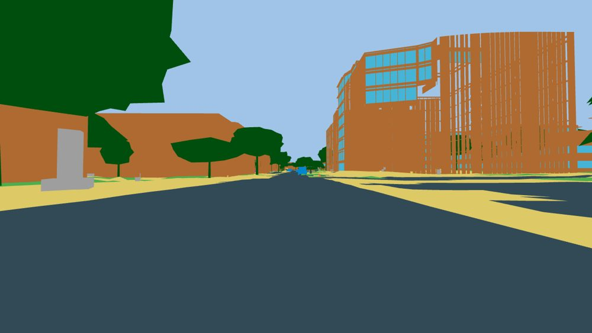
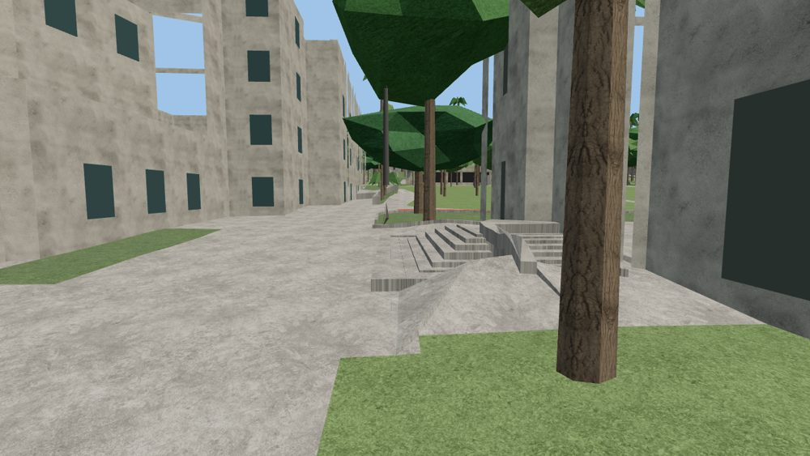
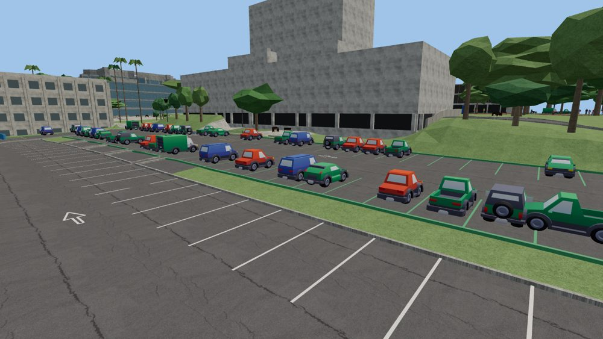

# The 3D Training World

`campus-rover build-world` turns a site into a labelled 3D world the rover's vision models can train in. The first one covers the UH Mānoa route corridor: **Holmes Hall → Campus Center → Architecture**, an 869 × 674 m box.

| From above | Holmes Hall and POST |
|---|---|
|  |  |

| Rover camera (0.7 m high) | Labels for training |
|---|---|
|  |  |

| Real stair treads at the Architecture building | Painted curb, sidewalk and road |
|---|---|
|  |  |

The plan and the reasoning behind it are in [CAMPUS_3D_PLAN.md](CAMPUS_3D_PLAN.md).

## The sourcing rule: nothing in the corridor is guessed

Every shape, position and colour near the route comes from a named data source. Where there is no evidence, the world shows less instead of inventing something.

| Part | Source | If there is no data |
|---|---|---|
| Terrain | 2022–2023 NOAA/USGS lidar, ground points | Site is built flat and says so |
| Ground surfaces: road, walkway, grass, planter, gravel, ramp | UH campus map land-cover polygons (the layer behind UH's printed basemap) | Lidar brightness plus mapped roads |
| Curbs, and which are painted red, yellow, green or blue | UH land cover | No curb |
| Stairs | UH land cover has every tread as its own polygon; each is set flat at the lidar ground height under it | No stairs |
| Walls and rock walls | UH land cover for the outline; height from the lowest solid lidar returns inside it | **Drawn flat** when the lidar measured no height |
| Parking-stall and sports-field lines | UH basemap lines, with their colours | No lines |
| Building footprints | UH campus map; City and County of Honolulu footprints; OpenStreetMap | Building is not built |
| Building shape and roof type | Lidar roof heights inside each footprint | One box at the mapped height |
| Wall colour, windows, shading, ground floor | A style sheet citing UH's photo of that building | **Plain grey shape, no windows** (`unverified`) |
| Number of floors | UH Planning's floor-plan PDFs: one sheet per level (76 of the 95 buildings) | The photo, when it shows the floors; otherwise the measured height |
| Roof colour | The photo, when it shows the roof; otherwise a grey whose lightness is the measured lidar brightness of that roof | Neutral grey |
| Doors | UH's Automatic Doors layer | **No door** |
| Trees | UH tree survey: position, species, height, crown | Height from the lidar canopy |
| Props | UH campus map layers | Not placed |
| Street lights | UH's light-pole survey for the position; lidar for the height | **Not drawn** when the lidar shows no pole 2–12 m tall |

Generic "background" buildings are only allowed more than 120 m from the route. The year a building was built is never used to guess its look.

**What still involves judgement.** Curbs are drawn 15 cm high, the standard 6-inch curb: the lidar grid is too coarse to measure a curb (it shows a smoothed 5 cm step). Textures are generic CC0 material photos from Poly Haven, tinted to each surface's colour; they show what concrete or asphalt looks like, not UH's actual pavement. Wall colours and window patterns are read off one photo per building by eye. Floor counts come from UH's floor plans for 76 buildings; for the other 19 they come from the photo or the measured height. A plan's count covers the whole building, so it is matched to the roof level it explains best, which leaves a few odd floor heights (Gartley and Miller Halls at 5.7 m, George Hall at 2.7 m) where a raised basement or a sloping site is involved. Prop shapes are generic and their facing is arbitrary. People and vehicles are synthetic by design.

### Checks against official data the world was not built from

| Check | Result |
|---|---|
| Lidar ground vs. Honolulu 5 ft contours (3,837 points) | Median difference 0.46 m, 90 % within 1.64 m |
| Lidar ground vs. State 100 ft contour (207 points) | Median difference 0.58 m |
| Lidar building heights vs. Honolulu footprint heights (78 buildings) | Median difference 2.2 m; 62 % within 3 m |

The contour check found that the lidar files measure height from a different reference: they sat a steady 21.8 m above both contour sets. `world.vertical_shift_m: -21.8` in `site.yaml` corrects that. The building-height gap is expected: Honolulu's figure is highest point minus lowest ground, ours is the main roof above typical ground.

## What is in it

| Part | Count (UH corridor) |
|---|---|
| Campus buildings, each with a photo-based style sheet | 95 |
| Other buildings from city and OSM footprints | 64: 13 near the route as plain grey, 51 far background |
| Open areas left to the terrain (tennis courts, amphitheatre) | 2 |
| Doors | 16, on 8 buildings |
| Ground polygons | 3,880: walkways, roads, lawns, planters, ramps, gravel, courts, water |
| Stair treads | 1,518 |
| Curbs | 989, of which 205 painted (red, yellow, green, blue) |
| Walls | 830: 157 with a measured height, 673 drawn flat |
| Painted line segments | 15,524 |
| Trees | 2,057: 1,229 with surveyed height, 828 with lidar height |
| Benches, bins, call boxes, bike racks and more | 752, of which 422 benches use a real CC0 model |
| Street lights | 197 placed at lidar-measured heights; 478 surveyed lights not drawn (bollard and wall lights the lidar cannot size) |
| People, bikes, skateboards, cars, carts, chickens, cats | 1,335 at a Monday class change |

Every mesh has a semantic label: `road`, `walkway`, `grass`, `curb`, `stairs`, `ramp`, `wall`, `planter`, `gravel`, `rock`, `water`, `sports_court`, `road_marking`, `building`, `window`, `door`, `roof`, `tree`, `person`, `bicycle`, `skateboard`, `car`, `cart`, `chicken`, `cat`, and one per prop type (`bench`, `trash_can`, `emergency_call_box`, ...).

## Build it

```bash
pip install -e ".[dev,world-data]"
```

```bash
campus-rover fetch-layers --site uh_manoa
```

```bash
campus-rover fetch-world-data --site uh_manoa
```

```bash
campus-rover fetch-assets --site uh_manoa
```

```bash
campus-rover build-world --site uh_manoa --out out/uh_manoa --scenario class_change
```

```bash
campus-rover view --dir out/uh_manoa
```

- `fetch-layers` downloads the UH campus map layers (buildings, trees, props, doors).
- `fetch-world-data` downloads walkways and roads, six lidar tiles (about 315 MB), and the official open data listed below. Downloads go to `sites/uh_manoa/cache/`, which is not in git.
- `fetch-assets` downloads the free 3D models listed in `assets.py`. Without them the build still works and uses simple stand-in shapes.
- `build-world` takes about 40 seconds and writes:

| File | For |
|---|---|
| `world.usdc` + `textures/` | **Isaac Sim.** Z up, meters, labels, collision, textured preview materials. Keep the `textures` folder next to the file. |
| `agents_<scenario>.usdc` | People and vehicles for one scenario, as a separate layer. |
| `world.glb`, `agents_<scenario>.glb` | The browser viewer, Blender, anything that reads glTF. |
| `world.json` | Report: each building's tier, height, floors and where its look came from; the checks above; every source with its retrieval date. |
| `index.html` | The viewer: fly around, ride the route at rover height, switch to label colours. |

The demo campus builds with no downloads: `campus-rover build-world --site demo_campus --out out/demo --scenario test`. It is an invented site with no lidar, so the ground is flat and buildings are boxes.

### In Isaac Sim

Open `world.usdc`, add `agents_class_change.usdc` as a sublayer or reference, add a Physics Scene, and drop in the rover. Site coordinates are recentred; the offset is stored in the layer metadata as `campus:originOffset`.

## Free 3D models

A model is stored once and placed many times, so 422 benches cost one bench. `assets.py` lists each model with its source and licence, and `world.json` repeats that under `model_sources`.

| Model | Source | Licence | Placed where |
|---|---|---|---|
| Six cars: sedan, hatchback, SUV, van, pickup, delivery van | Kenney, *Car Kit* | CC0 | Mapped parking stalls and on roads, per scenario |
| Bench | Poly Haven, *painted_wooden_bench* | CC0 | UH's Outdoor Seating points |
| Street light | Poly Haven, *street_lamp_01* | CC0 | UH's surveyed light poles, scaled to the lidar height |

All are generic shapes: UH's real benches and lamp types look different, and the cars are low-poly with toy-like proportions (about 3.5 m long, wider and taller than a real car). Their positions are real or come from the scenario.



**Still stand-ins: people, bikes, animals.** Microsoft's Rocketbox avatars (MIT licence, 115 rigged people) are the right source for people, but they ship as FBX files and the converter could not be run in the cloud build session. poly.pizza, which hosts CC0 bikes and animals, sits behind a browser check that scripts cannot pass. In Isaac Sim, the simplest route is its own bundled people and vehicles.

### Why Street View is not used

Pulling Google Street View panoramas and rebuilding the campus from them is not done here, with either the official API or an unofficial downloader. Google's Maps Platform terms forbid bulk downloading, building 3D models or other content from its imagery, and using it to train machine-learning models; the images are Google's copyright, and this repository is public. See [SCOPE.md §3a](SCOPE.md).

The same technique works on imagery you are allowed to use: a 360° photo with known coordinates is projected onto the model to check and colour it. Sources that qualify are your own 360° or phone footage of the routes, and Mapillary (CC BY-SA, with coordinates) if it has coverage on campus.

## Scenarios

A scenario is a small file in `sites/<site>/scenarios/`:

```yaml
name: class_change
time: "Mon 09:20"
seed: 7
```

The time drives the same crowd model the route planner uses, so walkways near lecture halls fill up at class changes. Other settings: `people_scale`, `min_people_per_100m`, `wheeled_share`, `parked_share`, `moving_car_every_m`, `carts`, `chickens`, `cats`. Change the `seed` for a different arrangement of the same crowd.

## Building style sheets

One file per building, about 20 lines, checked by code. Every sheet must cite its source.

```yaml
id: holmes_hall
floors: 5
wall: '#b9b4aa'
roof: null              # not visible in the photo: lightness is measured from lidar
windows: grid
shading: lanai          # open-air corridors
ground_floor: arcade
confidence: medium
sources: [https://map.hawaii.edu/images/MA/building_images/1163_01.jpg, ...]
```

- `windows`: `grid`, `ribbon`, `curtain`, `slit` or `none`
- `shading`: `none`, `fins`, `eyebrows` or `lanai`
- `ground_floor`: `solid`, `arcade` or `storefront`
- `solid: false` marks an open area such as courts, which is not built as a block.

**To correct a building, edit its file and rebuild.** If you know the campus, this is the fastest way to improve the world.

## What is not right yet

| Limit | Why | Fix |
|---|---|---|
| Still not a photo | Textures are generic tiling materials, lighting is simple, windows are flat dark panels. The State's aerial imagery is licensed from Maxar, so it is not used. | Splats from your own footage |
| 673 of 830 walls are flat | The lidar saw no clear wall top there, often under trees | Your photos or notes of wall heights |
| The world file is about 50 MB | Each textured building face needs its own vertices | Fine for Isaac Sim; slower to load in a browser |
| People and vehicles are blocky | Procedural stand-ins; see "Free 3D models" for what blocked real ones | Rocketbox people once the FBX files can be converted; Isaac Sim's bundled people and vehicles |
| Benches, street lights and cars are generic shapes | No model of UH's actual furniture exists; the free cars are toy-proportioned | Your photos, then matching models; Isaac Sim's vehicles |
| Most buildings have no door | UH maps only automatic doors: 16 in the corridor | Your photos or notes of where entrances are |
| 13 buildings near the route are plain grey | City or OSM footprints that UH's map does not name, so there is no photo | Tell me what they are; `world.json` lists them as `unverified` |
| Styles come from one photo each; 47 of them from small thumbnails | UH's campus-map photos | Your corrections; more photos |
| The route takes roads in places | OpenStreetMap has few UH footpaths | Add paths in OSM, or derive them from the paved-ground map |
| Not yet opened in Isaac Sim | No GPU in the build environment | Open `world.usdc` on an RTX machine |

## Data and credit

| Source | Used for |
|---|---|
| 2022–2023 NOAA/USGS Hawaiʻi lidar (public domain) | Terrain, roof shapes, tree heights, ground type, roof lightness |
| University of Hawaiʻi at Mānoa campus map | Land cover (surfaces, curbs, stair treads, walls, ramps); painted lines; building footprints, names, numbers and abbreviations; trees; props; automatic doors; building photos. UH marks its layers "for visualization purposes only"; downloads stay out of this repo. |
| City and County of Honolulu Open Geospatial Data, *Building Footprints (CCH)* | Footprints of buildings UH's map lacks; height check |
| City and County of Honolulu, *Elevation 5ft* and *Zoning* | Terrain check; zoning classes recorded in `world.json` |
| State of Hawaiʻi GIS, *Oahu Elevation Contours 100ft* | Terrain check |
| PacIOOS GeoServer: government land ownership, watersheds, streams | Regional context recorded in `world.json`. Its server only offers an older key exchange, so the cipher level is lowered for that host alone; its certificate is still checked. |
| UH Mānoa Library MAGIS | Consulted as a reference. It serves no machine-readable campus layers. |
| UH Mānoa Planning, floor-plan PDFs | Floor counts only. UH asks that the plans are not passed on, so the PDFs stay in `cache/` and out of this repo. |
| Kenney (CC0) | Six car models from the *Car Kit* |
| Poly Haven (CC0) | Nine tiling material textures in `src/campus_rover/textures/`, listed with their sources in `textures.json`; the bench and street-light models |
| © OpenStreetMap contributors (ODbL), via Overture Maps | Walkways, roads, footprints the city layer lacks. `sites/uh_manoa/graph.osm.yaml` is derived from that data. |
