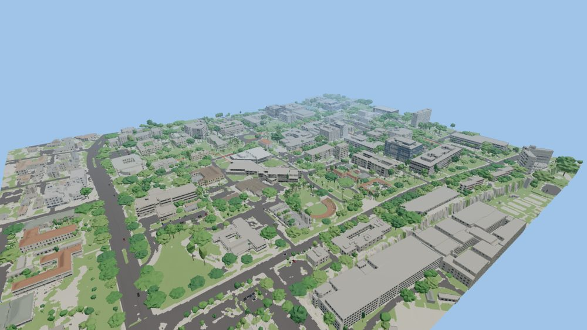
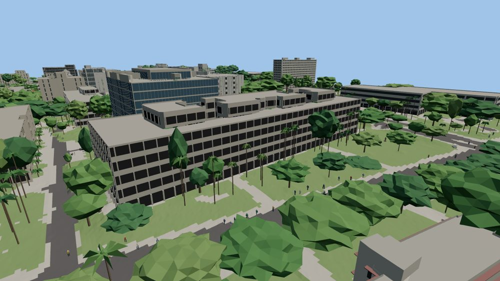
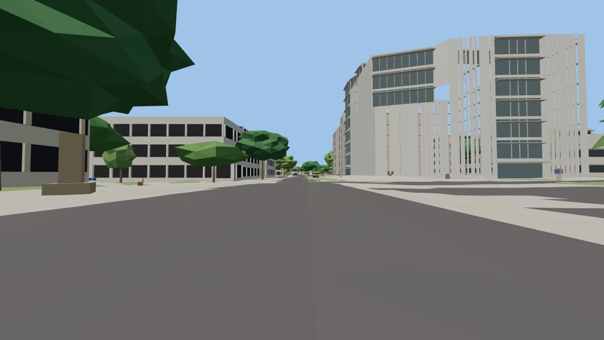

# The 3D Training World

`campus-rover build-world` turns a site into a labelled 3D world the rover's vision models can train in. The first one covers the UH Mānoa route corridor: **Holmes Hall → Campus Center → Architecture**, an 870 × 676 m box.

| From above | Holmes Hall and POST |
|---|---|
|  |  |

| Rover camera (0.7 m high) | The same view as labels |
|---|---|
|  |  |

The plan and the reasoning behind it are in [CAMPUS_3D_PLAN.md](CAMPUS_3D_PLAN.md).

## What is in it

| Part | Where it comes from | Count (UH corridor) |
|---|---|---|
| Terrain, 25–70 m elevation | 2022–2023 NOAA/USGS lidar, ground points | 1 m grid |
| Ground type: road, walkway, grass | Lidar brightness (asphalt is dark, grass is bright) plus mapped roads | every cell |
| Building shapes: towers, podiums, courtyards, pitched roofs | UH campus map footprints + lidar roof heights | 97 UH buildings |
| Building looks: colours, windows, sun shading, ground floor, doors | Style sheets in `sites/uh_manoa/buildings/` | 50 researched, 47 guessed from the year built |
| Off-campus buildings | Overture Maps footprints + lidar heights | background only |
| Trees, with real height, crown width and palm vs. broadleaf | UH's tree survey | 2,065 |
| Benches, bins, call boxes, bike racks and more | UH campus map layers | 752 |
| People, bikes, skateboards, cars, carts, chickens, cats | Crowd model + scenario file | 1,335 at a Monday class change |

Every mesh has a semantic label: `road`, `walkway`, `grass`, `building`, `window`, `door`, `roof`, `tree`, `person`, `bicycle`, `skateboard`, `car`, `cart`, `chicken`, `cat`, and one per prop type (`bench`, `trash_can`, `emergency_call_box`, ...).

## Build it

```bash
pip install -e ".[dev,world-data]"
```

```bash
campus-rover fetch-layers --site uh_manoa
```

```bash
campus-rover fetch-world-data --site uh_manoa
```

```bash
campus-rover build-world --site uh_manoa --out out/uh_manoa --scenario class_change
```

```bash
campus-rover view --dir out/uh_manoa
```

- `fetch-layers` downloads the UH campus map layers (buildings, trees, props).
- `fetch-world-data` downloads the walkways, roads, off-campus footprints and six lidar tiles (about 315 MB), then grids the lidar. Downloads go to `sites/uh_manoa/cache/`, which is not in git.
- `build-world` takes about 30 seconds and writes:

| File | For |
|---|---|
| `world.usdc` | **Isaac Sim.** Z up, meters, labels, collision, preview materials. |
| `agents_<scenario>.usdc` | People and vehicles for one scenario, as a separate layer. |
| `world.glb`, `agents_<scenario>.glb` | The browser viewer, Blender, anything that reads glTF. |
| `world.json` | Report: every building with its tier, height and floors; the route; counts. |
| `index.html` | The viewer: fly around, ride the route at rover height, switch to label colours. |

The demo campus builds with no downloads: `campus-rover build-world --site demo_campus --out out/demo --scenario test`. It has no lidar, so the ground is flat and buildings are boxes.

### In Isaac Sim

Open `world.usdc`, add `agents_class_change.usdc` as a sublayer or reference, add a Physics Scene, and drop in the rover. Site coordinates are recentred; the offset is stored in the layer metadata as `campus:originOffset`.

## Scenarios

A scenario is a small file in `sites/<site>/scenarios/`:

```yaml
name: class_change
time: "Mon 09:20"
seed: 7
```

The time drives the same crowd model the route planner uses, so walkways near lecture halls fill up at class changes. Other settings: `people_scale`, `min_people_per_100m`, `wheeled_share`, `parked_share`, `moving_car_every_m`, `carts`, `chickens`, `cats`. Change the `seed` for a different arrangement of the same crowd.

## Building style sheets

One file per building, about 20 lines, checked by code:

```yaml
id: holmes_hall
tier: A
floors: 5
wall: '#b9b4aa'
windows: grid
shading: lanai          # open-air corridors
ground_floor: arcade
entrances: [{side: N, kind: wide, covered: true}]
confidence: medium
sources: [https://map.hawaii.edu/images/MA/building_images/1163_01.jpg, ...]
```

- `windows`: `grid`, `ribbon`, `curtain`, `slit` or `none`
- `shading`: `none`, `fins`, `eyebrows` or `lanai`
- `ground_floor`: `solid`, `arcade` or `storefront`
- **Tier A** is within 45 m of the route, **B** within 120 m, **C** is background.

**To correct a building, edit its file and rebuild.** If you know the campus, this is the fastest way to improve the world: fix a colour, a floor count, or which side the entrance is on.

## What is not right yet

| Limit | Why | Fix |
|---|---|---|
| Looks like a game level, not a photo | Flat colours, no textures | CC0 textures (Poly Haven), then splats from real footage |
| People and vehicles are blocky | Procedural stand-ins | Rigged assets in Isaac Sim (Microsoft Rocketbox, Isaac Sim people) |
| Ground types have jagged 1 m edges; no curbs or real steps | Classified per cell from lidar brightness | Vector outlines for the route; stepped stair geometry |
| Styles come from one photo per building | UH's campus-map photo | Your corrections; more photos |
| Doors are placed on the right side, not the exact spot | No door positions in the data | UH's automatic-door and elevator layers; your corrections |
| The route takes roads in places | OpenStreetMap has few UH footpaths | Add paths in OSM, or derive them from the paved-ground map |
| Not yet opened in Isaac Sim | No GPU in the build environment | Open `world.usdc` on an RTX machine |

## Data and credit

- Lidar: 2022–2023 NOAA/USGS Hawaiʻi lidar, public domain.
- Buildings, trees, props and building photos: University of Hawaiʻi at Mānoa campus map. UH marks its layers "for visualization purposes only"; downloads stay out of this repo.
- Walkways, roads and off-campus footprints: © OpenStreetMap contributors (ODbL), via Overture Maps. `sites/uh_manoa/graph.osm.yaml` is derived from that data.
