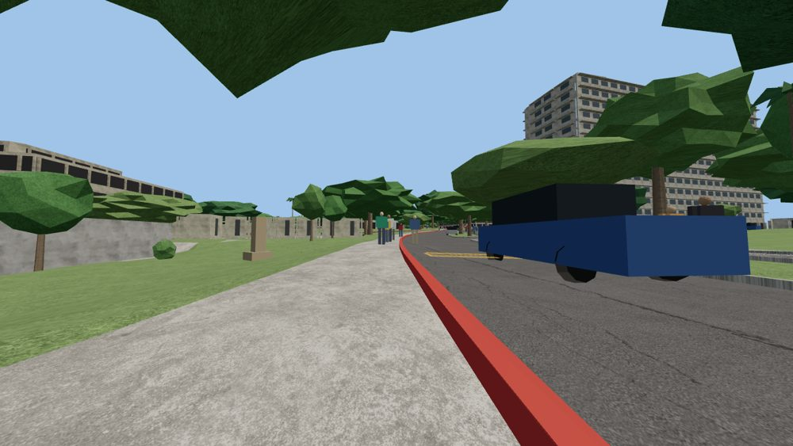
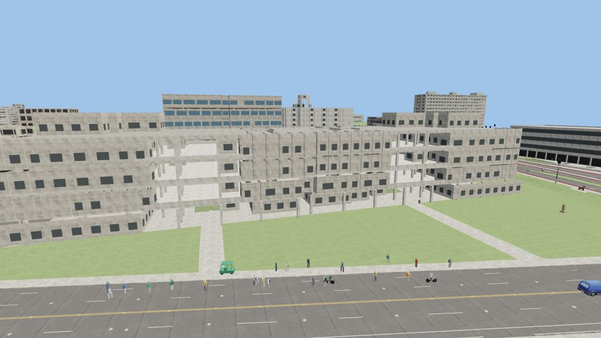
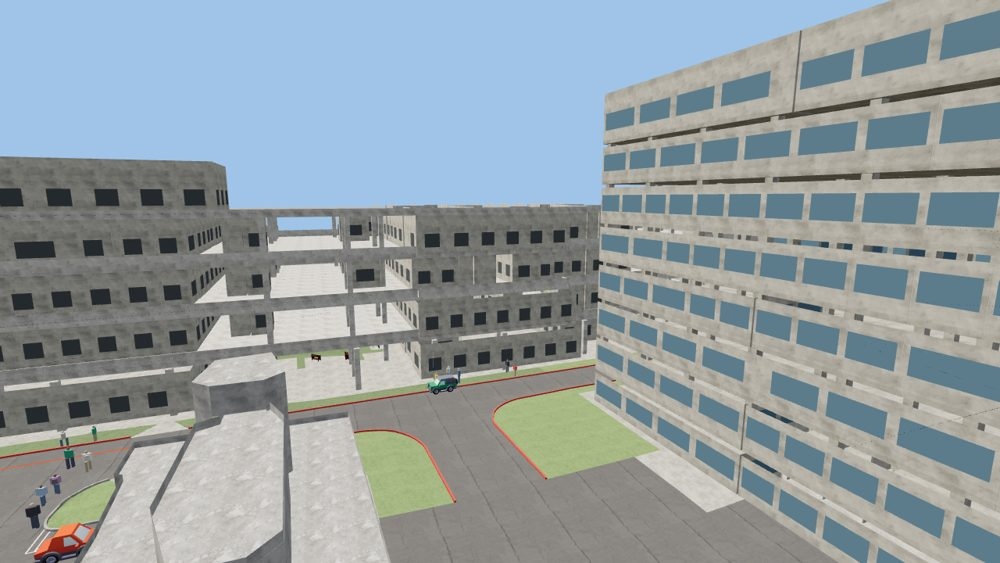
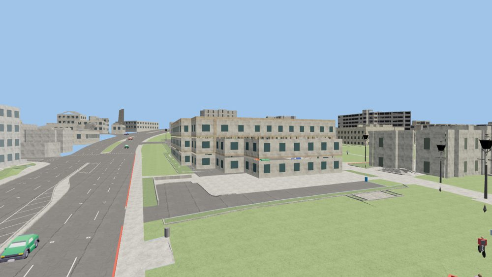
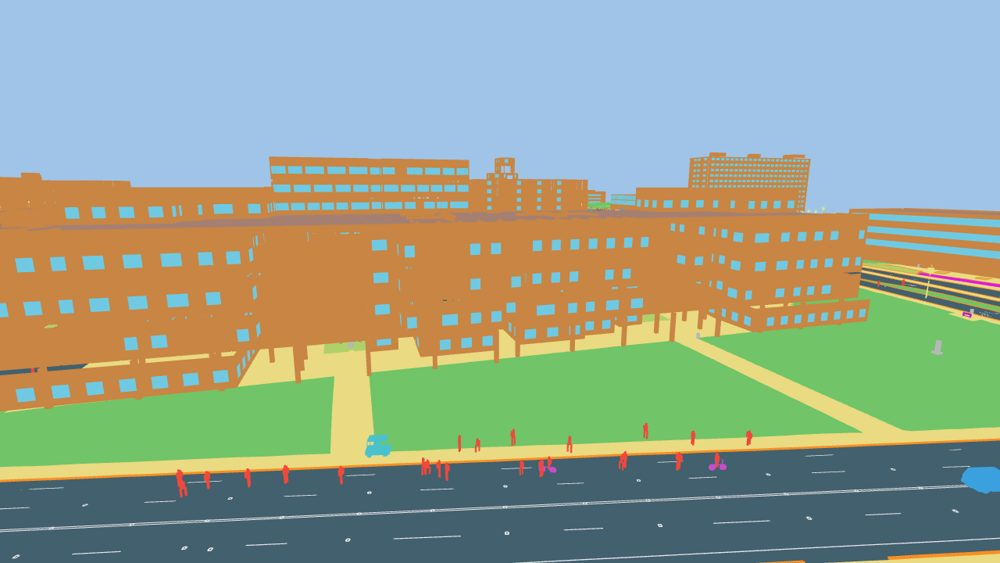
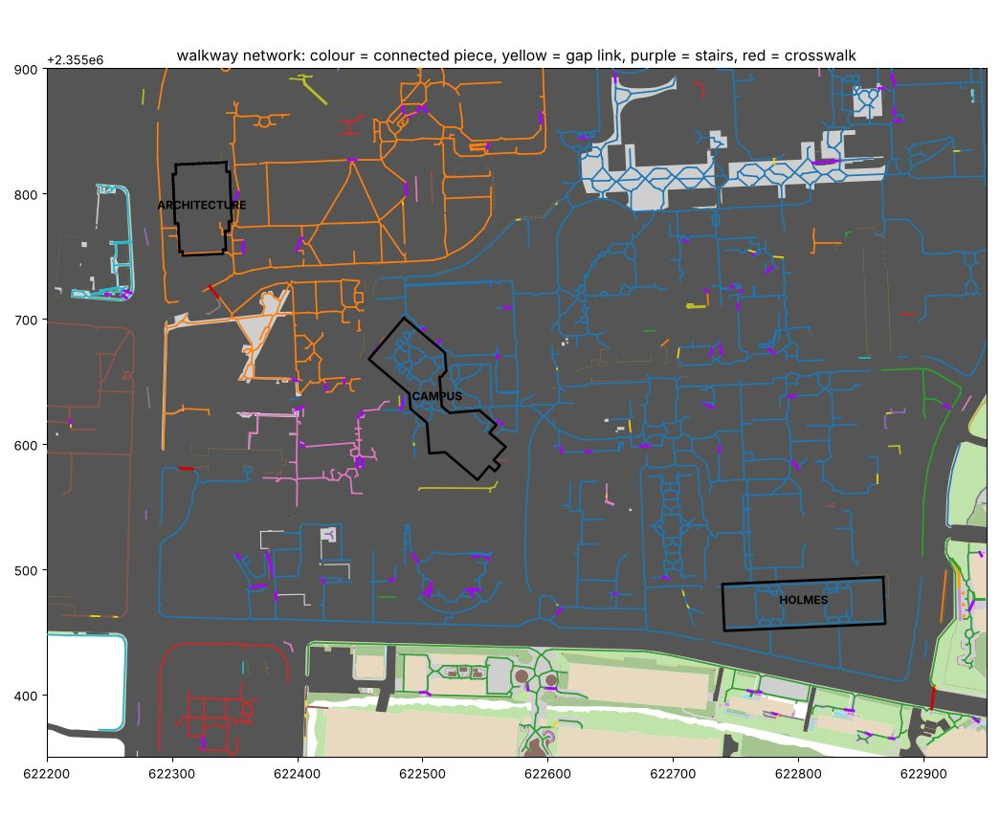
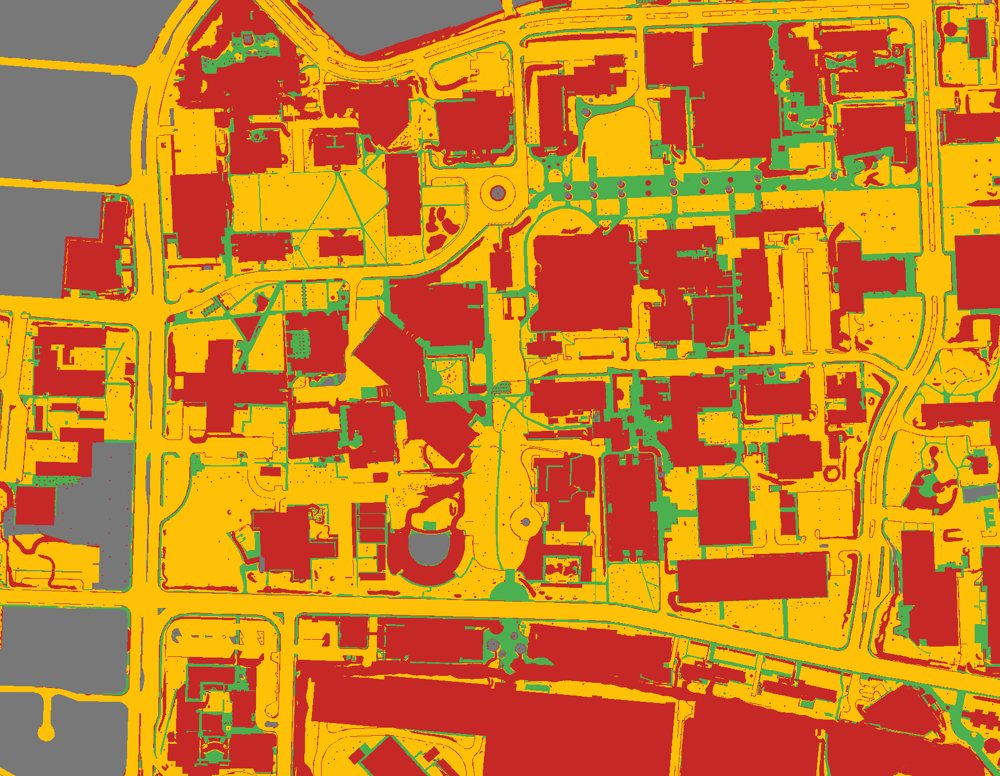

# The 3D Training World

`campus-rover build-world` turns a site into a labelled 3D world the rover's vision models can train in. The first one covers the UH Mānoa route corridor: **Holmes Hall → Campus Center → Architecture**, an 869 × 674 m box.

| From above | Holmes Hall and POST |
|---|---|
|  |  |

| Rover camera (0.7 m high) | Labels for training |
|---|---|
|  |  |

| Real stair treads at the Architecture building | Painted curb, sidewalk and road |
|---|---|
|  |  |

The plan and the reasoning behind it are in [CAMPUS_3D_PLAN.md](CAMPUS_3D_PLAN.md).

## The sourcing rule: nothing in the corridor is guessed

Every shape, position and colour near the route comes from a named data source. Where there is no evidence, the world shows less instead of inventing something.

| Part | Source | If there is no data |
|---|---|---|
| Terrain | 2022–2023 NOAA/USGS lidar, ground points | Site is built flat and says so |
| Ground surfaces: road, walkway, grass, planter, gravel, ramp | UH campus map land-cover polygons (the layer behind UH's printed basemap) | Lidar brightness plus mapped roads |
| Curbs, and which are painted red, yellow, green or blue | UH land cover | No curb |
| Stairs | UH land cover has every tread as its own polygon; each is set flat at the lidar ground height under it | No stairs |
| Walls and rock walls | UH land cover for the outline; height from the lowest solid lidar returns inside it | **Drawn flat** when the lidar measured no height |
| Parking-stall and sports-field lines | UH basemap lines, with their colours | No lines |
| Building footprints | UH campus map; City and County of Honolulu footprints; OpenStreetMap | Building is not built |
| Building shape and roof type | Lidar roof heights inside each footprint | One box at the mapped height |
| Floor layout (slabs, courtyards, open galleries, room blocks, columns) | UH floor plans fitted onto the lidar roof, for buildings whose style sheet says how their corridors work (6 so far) | Roof-level blocks from the lidar, as before |
| Wall colour, windows, shading, ground floor | A style sheet citing UH's photo of that building | **Plain grey shape, no windows** (`unverified`) |
| Number of floors | UH Planning's floor-plan PDFs: one sheet per level (76 of the 95 buildings) | The photo, when it shows the floors; otherwise the measured height |
| Roof colour | The photo, when it shows the roof; otherwise a grey whose lightness is the measured lidar brightness of that roof | Neutral grey |
| Doors | UH's Automatic Doors layer | **No door** |
| Trees | UH tree survey: position, species, height, crown | Height from the lidar canopy |
| Props | UH campus map layers | Not placed |
| Street lights | UH's light-pole survey for the position; lidar for the height | **Not drawn** when the lidar shows no pole 2–12 m tall |

Generic "background" buildings are only allowed more than 120 m from the route. The year a building was built is never used to guess its look.

**What still involves judgement.** Curbs are drawn 15 cm high, the standard 6-inch curb: the lidar grid is too coarse to measure a curb (it shows a smoothed 5 cm step). Textures are generic CC0 material photos from Poly Haven, tinted to each surface's colour; they show what concrete or asphalt looks like, not UH's actual pavement. Wall colours and window patterns are read off one photo per building by eye. Floor counts come from UH's floor plans for 76 buildings; for the other 19 they come from the photo or the measured height. A plan's count covers the whole building, so it is matched to the roof level it explains best, which leaves a few odd floor heights (Gartley and Miller Halls at 5.7 m, George Hall at 2.7 m) where a raised basement or a sloping site is involved. Prop shapes are generic and their facing is arbitrary. People and vehicles are synthetic by design.

### Checks against official data the world was not built from

| Check | Result |
|---|---|
| Lidar ground vs. Honolulu 5 ft contours (3,837 points) | Median difference 0.46 m, 90 % within 1.64 m |
| Lidar ground vs. State 100 ft contour (207 points) | Median difference 0.58 m |
| Lidar building heights vs. Honolulu footprint heights (78 buildings) | Median difference 2.2 m; 62 % within 3 m |

The contour check found that the lidar files measure height from a different reference: they sat a steady 21.8 m above both contour sets. `world.vertical_shift_m: -21.8` in `site.yaml` corrects that. The building-height gap is expected: Honolulu's figure is highest point minus lowest ground, ours is the main roof above typical ground.

## What is in it

| Part | Count (UH corridor) |
|---|---|
| Campus buildings, each with a photo-based style sheet | 95 |
| Other buildings from city and OSM footprints | 64: 13 near the route as plain grey, 51 far background |
| Open areas left to the terrain (tennis courts, amphitheatre) | 2 |
| Doors | 16, on 8 buildings |
| Ground polygons | 3,880: walkways, roads, lawns, planters, ramps, gravel, courts, water |
| Stair treads | 1,518 |
| Curbs | 989, of which 205 painted (red, yellow, green, blue) |
| Walls | 830: 157 with a measured height, 673 drawn flat |
| Painted line segments | 15,524 |
| Trees | 2,057: 1,229 with surveyed height, 828 with lidar height |
| Benches, bins, call boxes, bike racks and more | 752, of which 422 benches use a real CC0 model |
| Street lights | 197 placed at lidar-measured heights; 478 surveyed lights not drawn (bollard and wall lights the lidar cannot size) |
| People, bikes, skateboards, cars, carts, chickens, cats | 1,335 at a Monday class change |

Every mesh has a semantic label: `road`, `walkway`, `grass`, `curb`, `stairs`, `ramp`, `wall`, `planter`, `gravel`, `rock`, `water`, `sports_court`, `road_marking`, `building`, `window`, `door`, `roof`, `tree`, `person`, `bicycle`, `skateboard`, `car`, `cart`, `chicken`, `cat`, and one per prop type (`bench`, `trash_can`, `emergency_call_box`, ...).

## Build it

```bash
pip install -e ".[dev,world-data]"
```

```bash
campus-rover fetch-layers --site uh_manoa
```

```bash
campus-rover fetch-world-data --site uh_manoa
```

```bash
campus-rover fetch-assets --site uh_manoa
```

```bash
campus-rover build-world --site uh_manoa --out out/uh_manoa --scenario class_change
```

```bash
campus-rover view --dir out/uh_manoa
```

- `fetch-layers` downloads the UH campus map layers (buildings, trees, props, doors).
- `fetch-world-data` downloads walkways and roads, six lidar tiles (about 315 MB), and the official open data listed below. Downloads go to `sites/uh_manoa/cache/`, which is not in git.
- `build-plans` fits UH's floor-plan PDFs (cached in `cache/floorplans/` by earlier floor-count runs) onto their buildings and saves the layouts to `cache/plans/`. Run it before `build-world` to build from plans.
- `build-walknet`, `build-traversal` and `measure-curbs` build the rover's network and labels from the cached survey (see "For the rover" below).
- `fetch-assets` downloads the free 3D models listed in `assets.py`. Without them the build still works and uses simple stand-in shapes.
- `build-world` takes about 40 seconds and writes:

| File | For |
|---|---|
| `world.usdc` + `textures/` | **Isaac Sim.** Z up, meters, labels, collision, textured preview materials. Keep the `textures` folder next to the file. |
| `agents_<scenario>.usdc` | People and vehicles for one scenario, as a separate layer. |
| `world.glb`, `agents_<scenario>.glb` | The browser viewer, Blender, anything that reads glTF. |
| `world.json` | Report: each building's tier, height, floors and where its look came from; the checks above; every source with its retrieval date. |
| `index.html` | The viewer: fly around, ride the route at rover height, switch to label colours. |

The demo campus builds with no downloads: `campus-rover build-world --site demo_campus --out out/demo --scenario test`. It is an invented site with no lidar, so the ground is flat and buildings are boxes.

### In Isaac Sim

Open `world.usdc`, add `agents_class_change.usdc` as a sublayer or reference, add a Physics Scene, and drop in the rover. Site coordinates are recentred; the offset is stored in the layer metadata as `campus:originOffset`.

## Buildings built from their floor plans

Most buildings are an extruded outline with windows painted on. For six buildings the world is built from what UH's floor plans actually show, one floor at a time: **Holmes Hall, Architecture, Information Technology Center, Hawaiʻi Institute of Geophysics, Watanabe Hall and POST**.

| Holmes Hall from the south | Holmes Hall from the north |
|---|---|
|  |  |

| Architecture building | Holmes Hall as training labels |
|---|---|
|  |  |

(Trees are hidden in these views so the buildings can be seen.)

**What a floor plan gives that a photo and a roof cannot:**
- the real outline of every floor, with courtyard voids and the setbacks between levels;
- which parts of a floor have walls (rooms) and which are open (circulation), so Holmes Hall comes out as a concrete frame of open galleries with rooms in blocks, not a solid slab;
- the structural column grid, at its drawn positions;
- the number of full floors and any penthouse.

**How a plan is placed on the world** (`plans.py`, command `campus-rover build-plans`):
1. Each sheet is a vector drawing at a stated scale. Its room shapes are read directly.
2. The sheet is turned and slid over the building's lidar roof until the two agree. Sheets are drawn north-up or a quarter turn away, and all sheets of a building must share one angle. A sheet named East must end up in the east half.
3. A sheet named East meets the building's east end, which removes a one-bay (about 9 m) ambiguity in long repetitive buildings like Holmes.
4. Every level is shifted so its columns sit on the columns of the top full floor, because a building's structure stacks. On Holmes, 14–16 of the roughly 21 columns on each upper sheet land within 0.35 m of a ground-level column once shifted, which confirms the placement.
5. East and west halves are joined in the middle of their overlap.

**What is checked:** every full floor must agree with the roof (fit score at least 0.6, at least 85 % of the plan on a roof), the stacked slabs must reach the roof's extent to within 6 m, and each full floor must find the column grid. Of 75 buildings with plans, 34 pass.

**Why only six are used:** a plan labels a space "corridor", but not whether that corridor is open to the air or inside the walls. That decides whether you see a railing or a wall, and the plan does not say. It is read from the photos and recorded in each style sheet as `corridors: open` or `corridors: enclosed`. Holmes Hall, the Geophysics building and Watanabe Hall are open (photos show galleries and balconies); Architecture, the IT Center and POST are enclosed (photos show continuous windows or curtain walls). The other 28 buildings with a good fit have no such statement yet, so they stay on the roof-based model until someone has looked at their photos. Say which and I will.

**What is not from the plans:** wall and trim colours and the window pattern (photos), floor heights (the lidar main roof shared equally between the floors: 5.0 m on Holmes, 3.9 m on Architecture), and the windows themselves (a generic band on each room wall; the plans do not show windows). Doors are still only placed at UH's mapped door points, and the plans' interiors are not built.

**Known limits.** Placement is good to about ±3 m: the stacked slabs' extents match the roof to 3.7 m on Holmes and to 5.4 m on Architecture, and part of that is roof overhang. A building that is nearly symmetrical could in principle fit equally well turned half a circle; the East/West naming and the column grid guard against it, but cannot rule it out for a symmetrical single sheet. Architecture's mostly open ground-floor sheet cannot be aligned by columns, so its ground floor takes the footprint of the floor above (a solid base, as in UH's photos). The plans are for information only and UH asks that they stay private, so the PDFs and the fitted layouts stay in `cache/` and out of this repository.

## For the rover: network, traversability, physics

The world is also what a rover plans and drives on, so it carries a path network, labels for what can be driven on, and collision and friction for the physics engine. Details of the measurements are in [SIM_READINESS.md](SIM_READINESS.md).

| Walkway network (colour = connected piece, purple = stairs, red = crosswalk) | Traversability (green free, amber conditional, red blocked) |
|---|---|
|  |  |

### The walkway network (`walknet.py`, `campus-rover build-walknet`)

OpenStreetMap has few UH footpaths: the route planned on it ran **46 % on road and only 39 % on walkway**. The network is built from UH's surveyed walkway and ramp polygons instead.

1. Walkway and ramp polygons are joined (hairline gaps closed), then curbs, walls, planters, water and whole flights of stairs are removed. This order matters: closing after removing would bridge a thin wall.
2. The centerline (skeleton) becomes the edges, each with its **width**, its **grade** (measured on lidar ground, with the cells next to buildings thrown away because eaves and foundations make them unreliable), and whether it is a ramp.
3. Stair flights become `stairs` edges, so the planner knows they exist and does not use them.
4. Marked crosswalks (from OpenStreetMap, via Overture) become `crosswalk` edges. A crossing that arrives in the middle of a long path splits that path there.
5. Where the survey has a break, links of up to 12 m over grass or gravel join the pieces, flagged `gap`. They never cross a road, wall, curb or building. The build reports how many it added (37, 174 m in total), so a data break is never hidden.

Two assumptions are named in `WalkParams`: the narrowest strip counted as a path (1.0 m, to be set from the rover's real width) and the longest break bridged (12 m).

**What it says about the corridor.** Holmes Hall and Campus Center are in one piece. The Architecture side is a different piece, and the closest the two come is 9.7 m. A rover with the 8.3 % grade limit, no stairs and construction closures respected gets no route from Campus Center to Architecture, and Holmes → Campus Center needs two 7 m stretches that are too steep (one at 9 %, one at 56 %, probably a deck or stairs the survey lacks).

```bash
campus-rover blockers --site uh_manoa --route AB
```

`blockers` prints the least-blocked path and every stretch that stops a rover, with location and reason, or says the nearest points of two disconnected pieces. When there is no passable route `plan` now explains why instead of returning a route a rover could not drive (the old one ran down roads). Each blocker needs a human decision: is it a real barrier, a missing crossing in the data, or lidar misreading a terrace?

**Not known from the survey:** curb cuts. The survey draws curbs continuously and has no ramp polygon within 37 m of any crosswalk, so every crossing's `curb_cut` is `unknown`, not `false`. Set `planner.require_curb_cut` only once curb cuts have been checked in the field.

### Traversability (`traversal.py`, `campus-rover build-traversal`)

Each semantic class is `traversable`, `conditional` or `blocked`:
- traversable: walkway, ramp
- conditional: grass, gravel, dirt, road, stepping stones, rock, courts
- blocked: stairs, curbs, walls, planters, water, building slabs, buildings, trunks, furniture; people and vehicles are `dynamic`

Slope lowers a level: a walkway steeper than 8.3 % is conditional, steeper than 15 % blocked. The build writes a ground raster (level, slope, cost map with the rover's radius kept clear) and `traversability.json`, the class-to-level table for labelling rendered images. The same table is written onto every USD prim as `campus:traversability`. The levels are a policy: whether a rover may use a road or a 10 % grade is the rover's rule, and `Limits` and `LEVELS` are the places to change it.

### Crossings, ramps and goals (`crossings.py`, `walknet.py`, `planner.landmark_goals`)

- **Crossings.** UH's data has no crosswalk layer. `build-walknet` finds every place walkable ground faces walkable ground across a road (about 800 in the corridor, a ladder of near-identical lines along any road with a sidewalk each side) and ranks them by evidence: 4 `marked` (OpenStreetMap through Overture), 21 `supported` (a UH ramp or a gap in the curb at both ends), the rest `candidate`. Only the first three are used for routes. `curb_cut` is True only with a mapped ramp or curb gap at both ends. Zebra paint appears at `marked` and `confirmed` crossings only; the bar size is an assumption.
- **Confirming one.** The explorer lists "Crossing needed" where a route has to cross a road nobody mapped a crosswalk on. Walk it, write what you found in `sites/<site>/crossings.yaml`, rerun `build-walknet`: the crossing becomes `confirmed` and the route can use it.
- **Ramps.** Each of UH's 72 ramp polygons is a piece of path from its long axis, joined to the network, with the grade measured end to end on the lidar ground (a ramp is 1–3 m wide and the skeleton often misses it or runs beside it). Ramps at a street edge are `curb` ramps, the rest `access`. Centerlines that run along a flight of treads are labelled stairs.
- **Goals.** A building is reached when the rover can pull up anywhere within 4 m of its walls. The old single "landmark node" for Campus Center sat in a pocket reachable only by stairs, which made Holmes → Campus Center look blocked by two steep stretches. With the building-wide goal it is a 348 m route with no blocked stretch (narrowest 1.5 m, steepest 7.7 %).
- **Where it still stops.** Campus Center → Architecture needs one crossing of Campus Rd (about 9 m) or Farrington Rd (about 7.5 m). Both roads have continuous mapped curbs and no ramp, no marked crosswalk, so no crossing is usable until someone checks. The explorer draws every candidate line across each road.
- **Fences and gates** (UH fence layer): fences block the network and the traversability labels, gates stay open (conditional). Heights are assumptions (1.8 m chain-link, 1.2 m metal, 1.5 m gate). **Accessible parking** stalls (UH survey) get a blue square with a white centre.
- **The SVG map.** The uploaded SVG is a flattened print of Esri's topographic basemap (buildings, labels, bus stops, one polygon per park or path, no ramps or crosswalks). Parking lines, stairs, ramps, curbs, fences and street names come from UH's own layers at much higher detail, which is what the model uses.

### Plants, people, light and paving (from the route photos)

[ROUTE_PHOTOS.md](ROUTE_PHOTOS.md) lists what each photo shows. The model takes:

- **Trees** (`vegetation.py`): trunk and limbs in the scene (they collide), crown a shared prototype of leaf cards cut out by a texture drawn in the repo. The shape follows UH's species (coconut, feather and fan palms, monkeypod, banyan/kukui, plumeria, screwpine, paperbark); height, crown radius and trunk width are UH's. Far trees get fewer cards and a plain trunk.
- **Ground cover**: ti plants, ferns, grass tufts and bushes in UH's planter beds within 100 m of the route.
- **People** (`agents.py`): head, hair, neck, torso, arms with elbows, legs with knees, shoes (often shorts), backpacks, a walking stride; about 450 triangles each.
- **Furniture** (`furniture.py`): drum-shade lamp poles at UH's surveyed pole positions, white slotted trash cans.
- **Ground**: slab joints every 3 m in the concrete texture, running-bond brick pavers inside `paving.yaml` regions, curbs, walls and stairs no longer streaked.
- **Sculptures and seating** (`monuments.py`, `furniture.py`): the twelve outdoor art pieces nearest the route at UH's surveyed points, wood-slat benches and picnic tables by UH's seating type, green terrace stairs and stair handrails where photos show them. Sizes are estimates from photos unless a title gives them (Krypton).
- **Light** (explorer): a physical sky with the sun where it is over Honolulu at the chosen time, shadows, and a wet-pavement switch (**V**).
- **Route focus**: `build-explorer --focus 260` keeps what lies within 260 m of the route, so the hosted page's 64 MiB goes to the ground the rover drives on.

### Terrain and curbs

- **Curb height cannot be measured from this lidar.** Curb by curb, the ground steps up from road to sidewalk by 4.6 cm (middle half −4 to +14 cm) against a noise floor of about ±3.5 cm, from 412 curbs. `campus-rover measure-curbs` reproduces this. Curbs are therefore drawn at the standard 15 cm, as an assumption.
- **Slab joints and cracks** are not in any data set. They belong in domain randomisation, with the roughness ranges in `physics.py`, not in the baked world.
- **Slope** is real data: about 5 % of walkway length is steeper than 8.3 %.

### Collision and friction (`physics.py`)

Only things at wheel height collide: ground, curbs, stairs, walls, building walls, trunks (not tree crowns) and furniture. Roofs, windows, doors, road paint and agents do not. On the corridor that is 69 % of the scene's triangles (954k of 1.39M), building walls the largest share at 352k. Benches and street lights, placed many times, collide as convex hulls. Each collider is bound a physics material with friction.

**The friction numbers are placeholders.** They are typical ranges for rubber on each surface (concrete 0.6–0.9, grass 0.3–0.55, gravel 0.45–0.65, lower when wet), not measurements of UH's pavement. They need slide tests with the real rover, dry and wet. `sample_friction` draws from the ranges for randomisation. None of this has been run in Isaac Sim.

## Free 3D models

A model is stored once and placed many times, so 422 benches cost one bench. `assets.py` lists each model with its source and licence, and `world.json` repeats that under `model_sources`.

| Model | Source | Licence | Placed where |
|---|---|---|---|
| Six cars: sedan, hatchback, SUV, van, pickup, delivery van | Kenney, *Car Kit* | CC0 | Mapped parking stalls and on roads, per scenario |
| Bench | Poly Haven, *painted_wooden_bench* | CC0 | UH's Outdoor Seating points |
| Street light | Poly Haven, *street_lamp_01* | CC0 | UH's surveyed light poles, scaled to the lidar height |

All are generic shapes: UH's real benches and lamp types look different, and the cars are low-poly with toy-like proportions (about 3.5 m long, wider and taller than a real car). Their positions are real or come from the scenario.


**Still stand-ins: people, bikes, animals.** Microsoft's Rocketbox avatars (MIT licence, 115 rigged people) are the right source for people, but they ship as FBX files and the converter could not be run in the cloud build session. poly.pizza, which hosts CC0 bikes and animals, sits behind a browser check that scripts cannot pass. In Isaac Sim, the simplest route is its own bundled people and vehicles.

### Why Street View is not used

Pulling Google Street View panoramas and rebuilding the campus from them is not done here, with either the official API or an unofficial downloader. Google's Maps Platform terms forbid bulk downloading, building 3D models or other content from its imagery, and using it to train machine-learning models; the images are Google's copyright, and this repository is public. See [SCOPE.md §3a](SCOPE.md).

The same technique works on imagery you are allowed to use: a 360° photo with known coordinates is projected onto the model to check and colour it. Sources that qualify are your own 360° or phone footage of the routes, and Mapillary (CC BY-SA, with coordinates) if it has coverage on campus.

### Building photos

UH's campus map serves several photos per building (`<number>_01.jpg`, `_02.jpg`, ...). Every style sheet cites the ones it was read from; Holmes Hall, Campus Center and the Architecture building use three to five each. Wikimedia Commons was also tried as a second source, but it rate-limits the cloud build session, so no Commons photos are used yet.

## The viewer

`index.html` has shadows (one sun over the whole corridor), which show the recesses of open galleries. URL options, used for screenshots: `?hide=tree,person` hides classes, `?sun=x,y,z` moves the sun, `?shadows=0` turns shadows off, `?labels=1` shows training labels, `?rover=0.4` puts the camera on the route at that fraction.

## The explorer (walk through it and check it)

`campus-rover build-explorer --site uh_manoa --out out/explorer --scenario class_change` writes a folder that opens in any browser (`campus-rover view --dir out/explorer`) and can be published as a page. It is a lighter copy of the world (`build_world(lite=True)`: textures on the ground only, simpler tree crowns, no painted ground lines) split into three GLB files plus agents, each under the 20 MiB page limit, with the data in `data.json`:

- **Fly, Walk (eye 1.7 m) and Rover (camera 0.7 m).** Walking stands on the real ground mesh, cannot enter buildings, and the rover cannot climb a step above 12 cm, so curbs and stairs stop it and the status bar says why. Drawn geometry decides this: where stairs are modelled as a smooth slope, the rover rolls up them.
- **Network overlay** by connected piece, kind, grade, or rover can / cannot; **look** as real, "can a rover go here?" or class colours; click any surface for its class, building, ground grade and site coordinates.
- **Things to check** (97 on the corridor): the blocked stretches and the 9.7 m break on the Holmes → Campus Center → Architecture route, the 37 gap links, crosswalks with unknown curb cuts, steep walkways, construction closures, grey buildings, buildings built from floor plans, and low-confidence style sheets. Each can be marked looks right / looks wrong / unsure with a note; marks are kept in the browser (ids are stable across rebuilds) and **Copy my notes** puts them on the clipboard as JSON.
- Building list with facts and source links, a minimap that teleports, and route playback from the rover camera.

`--hosted` stores the 3D files as base64 text chunks (about a third larger, 65 MB in all) for page hosts that serve only text, images and fonts, which is how the published copy is made.

The explorer is for finding what is wrong, so it lists the model's own doubts rather than hiding them. Floor-plan layouts are part of the six plan-built buildings' geometry: publish the page only to people UH's plan terms allow.

## Scenarios

A scenario is a small file in `sites/<site>/scenarios/`:

```yaml
name: class_change
time: "Mon 09:20"
seed: 7
```

The time drives the same crowd model the route planner uses, so walkways near lecture halls fill up at class changes. Other settings: `people_scale`, `min_people_per_100m`, `wheeled_share`, `parked_share`, `moving_car_every_m`, `carts`, `chickens`, `cats`. Change the `seed` for a different arrangement of the same crowd.

## Building style sheets

One file per building, about 20 lines, checked by code. Every sheet must cite its source.

```yaml
id: holmes_hall
floors: 5
wall: '#b9b4aa'
roof: null              # not visible in the photo: lightness is measured from lidar
windows: grid
shading: lanai          # open-air corridors
ground_floor: arcade
confidence: medium
sources: [https://map.hawaii.edu/images/MA/building_images/1163_01.jpg, ...]
```

- `windows`: `grid`, `ribbon`, `curtain`, `slit` or `none`
- `shading`: `none`, `fins`, `eyebrows` or `lanai`
- `ground_floor`: `solid`, `arcade` or `storefront`
- `solid: false` marks an open area such as courts, which is not built as a block.

**To correct a building, edit its file and rebuild.** If you know the campus, this is the fastest way to improve the world.

## What is not right yet

| Limit | Why | Fix |
|---|---|---|
| Still not a photo | Textures are generic tiling materials, lighting is simple, windows are flat dark panels. The State's aerial imagery is licensed from Maxar, so it is not used. | Splats from your own footage |
| 673 of 830 walls are flat | The lidar saw no clear wall top there, often under trees | Your photos or notes of wall heights |
| The world file is about 50 MB | Each textured building face needs its own vertices | Fine for Isaac Sim; slower to load in a browser |
| People and vehicles are blocky | Procedural stand-ins; see "Free 3D models" for what blocked real ones | Rocketbox people once the FBX files can be converted; Isaac Sim's bundled people and vehicles |
| Benches, street lights and cars are generic shapes | No model of UH's actual furniture exists; the free cars are toy-proportioned | Your photos, then matching models; Isaac Sim's vehicles |
| Most buildings have no door | UH maps only automatic doors: 16 in the corridor | Your photos or notes of where entrances are |
| 13 buildings near the route are plain grey | City or OSM footprints that UH's map does not name, so there is no photo | Tell me what they are; `world.json` lists them as `unverified` |
| Styles come from one photo each; 47 of them from small thumbnails | UH's campus-map photos | Your corrections; more photos |
| The route takes roads in places | OpenStreetMap has few UH footpaths | Add paths in OSM, or derive them from the paved-ground map |
| Not yet opened in Isaac Sim | No GPU in the build environment | Open `world.usdc` on an RTX machine |

## Data and credit

| Source | Used for |
|---|---|
| 2022–2023 NOAA/USGS Hawaiʻi lidar (public domain) | Terrain, roof shapes, tree heights, ground type, roof lightness |
| University of Hawaiʻi at Mānoa campus map | Land cover (surfaces, curbs, stair treads, walls, ramps); painted lines; building footprints, names, numbers and abbreviations; trees; props; automatic doors; building photos. UH marks its layers "for visualization purposes only"; downloads stay out of this repo. |
| City and County of Honolulu Open Geospatial Data, *Building Footprints (CCH)* | Footprints of buildings UH's map lacks; height check |
| City and County of Honolulu, *Elevation 5ft* and *Zoning* | Terrain check; zoning classes recorded in `world.json` |
| State of Hawaiʻi GIS, *Oahu Elevation Contours 100ft* | Terrain check |
| PacIOOS GeoServer: government land ownership, watersheds, streams | Regional context recorded in `world.json`. Its server only offers an older key exchange, so the cipher level is lowered for that host alone; its certificate is still checked. |
| UH Mānoa Library MAGIS | Consulted as a reference. It serves no machine-readable campus layers. |
| UH Mānoa Planning, floor-plan PDFs | Floor counts only. UH asks that the plans are not passed on, so the PDFs stay in `cache/` and out of this repo. |
| Kenney (CC0) | Six car models from the *Car Kit* |
| Poly Haven (CC0) | Nine tiling material textures in `src/campus_rover/textures/`, listed with their sources in `textures.json`; the bench and street-light models |
| © OpenStreetMap contributors (ODbL), via Overture Maps | Walkways, roads, footprints the city layer lacks. `sites/uh_manoa/graph.osm.yaml` is derived from that data. |
