# Campus Rover v5: build guide

v5 keeps the v4.4 outside: frame, printed body, car steering, rocking front axle and tote. The changes are:

- **Rear drive:** two RobStride 00 actuators replace the hoverboard hub motors.
- **Battery:** a 48 V (13S) e-bike pack sits in an adjustable cradle.
- **Bay:** a universal grid replaces the fixed plates, so a different battery or board fits without new parts.

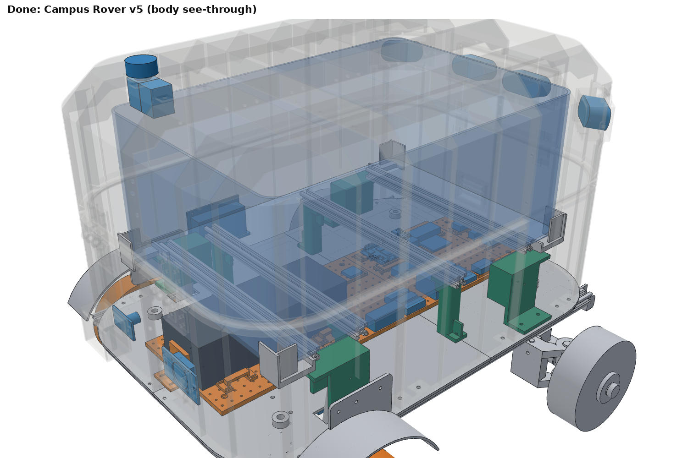

**Key numbers (checked in CAD, see the end):**

| | v4.4 | v5 |
|---|---|---|
| Rear drive | 2 hoverboard hub motors + 2 ZS-X11H drivers | 2 RobStride 00 (5 N·m continuous, 14 N·m peak, own driver, CAN) |
| Rear wheels | 6.5 in hub motors | 6 in x 1.5 in Colson on a 1/2 in hex shaft, 2 bearings per side |
| Top speed (13S pack) | — | about 2.0 m/s loaded (260 rpm), 2.5 m/s no load. Cruise is 1.2 m/s |
| Battery | 36 V 4.4 Ah (158 Wh) | 48 V 10 Ah (about 480 Wh) example. Any 13S pack up to 300 x 150 x 78 mm |
| Runtime | 3.5 to 4.5 h | about 9 to 13 h at 30 to 45 W average (estimate) |
| Compute | Pi 5 + Pico + phone | Pi 5 only, cameras only |
| Suspension | sprung rear, rocking front | the same: same pivot, same shock eyes, same shock |

---

## 1. Parts list

### 1a. Take out (from v4.4)

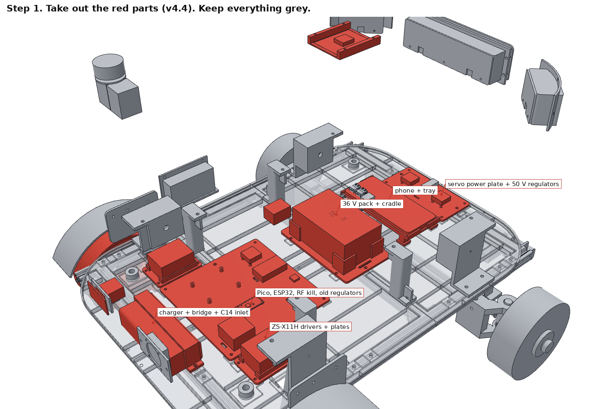

| Part | Why |
|---|---|
| 2x hoverboard hub motor, 2x swing arm, 2x axle clamp cap | replaced by the RS00 drive modules |
| 2x ZS-X11H driver + 2 driver plates | the RS00 has its own driver |
| Phone + phone tray, Raspberry Pi Pico, ESP32 tracker + its regulator, RF kill receiver, GPS + tray + ground plane | camera-only rover on the Pi 5 |
| 36 V pack + fixed battery cradle | replaced by a 48 V pack in the adjustable cradle (your 36 V pack still works, see section 2) |
| 42 V internal charger, charger hold-down ("rear bridge"), C14 AC inlet | the 48 V pack's own charger plugs into a DC socket in the old inlet cutout. The rain hood and flap stay |
| Pololu D36V50F5 (5 V) and 2x D36V50F7 (7.5 V) | rated 50 V max. A full 13S pack is 54.6 V. Replaced by the 60 V D42V55 versions |
| Old fuse + XT90 | replaced by 58 V-rated fuses and an XT90-S anti-spark key |
| Compute plate, servo power plate | replaced by the grid tiles |

**Keep:**
- Frame, body, steering (HBL380 servos, knuckles, C-hubs, pushrods, axle beam, pivot rod)
- Front wheels, pivot brackets, rear shocks, fenders, bumpers and roller switches
- E-stop button, Pi 5, BNO085 IMU, 74AHCT125 level shifter, USB hub, 4 webcams and the stereo pod, fan
- Glands, deck beams, tote guides, tote
- The green shock towers and deck posts, and the 608ZZ bearings and M8x50 bolts from the old swing arms

### 1b. Buy

| Qty | Part | What must match (anything else is your choice) | Example | About |
|---|---|---|---|---|
| 2 (+1 spare) | RobStride 00 | – | you have 3 | – |
| 1 | 48 V Li-ion pack (13S) | 13S, 54.6 V full, **common-port BMS** (braking energy goes back into the pack), ≥ 15 A continuous, **≤ 300 x 150 x 78 mm** | TGHY 13S4P 10.4 Ah, 267 x 85 x 67, comes with charger and XT60 ([Amazon](https://www.amazon.com/TGHY-Rechargeable-Connection-Capacity-Indicator/dp/B0F2H27FB1)); PZMCHL 10 Ah, 250 x 92 x 68 ([Amazon](https://www.amazon.com/PZMCHL-Connector-Compatible-200-1500W-Motorcycles/dp/B0GZZ417SF)); 13S4P 10 Ah, 255 x 95 x 70, $84.69 ([eBay](https://www.ebay.com/itm/147677276844)) | $85–150 |
| 1 | 54.6 V charger | fits the pack (often included) | – | – |
| 1 | DC solid-state relay | DC output ≥ 60 V (this one is 100 V), ≥ 10 A, 3.5–32 V control | Sensata Crydom D1D12, Digi-Key CC1037-ND | ~$80 |
| 1 | 5 V regulator for the Pi | input ≥ 60 V, 5 V ≥ 5 A | Pololu D42V55F5 (#5571) | ~$30 |
| 2 | 7.5 V regulator, one per servo | input ≥ 60 V, 7.5 V | Pololu D42V55F7 (#5574) | $31.95 each |
| 1 | USB-CAN adapter | SocketCAN (gs_usb / candleLight), 1 Mbit/s. RobStride's own SDK uses SocketCAN | CANable 2.0, Innomaker USB2CAN | $35–40 |
| 1 | PWM servo board | I2C, works at 3.3 V | Adafruit PCA9685 (815) | $14.95 |
| 4 | 1/2 in hex-bore flanged bearing, 1.125 in OD, 0.3125 in wide | these sizes (the arm's seats are cut for them) | AndyMark am-2986 | $4–6.50 each |
| 1 | 1/2 in hex shaft, aluminium, 12 in | cut 2 pieces of 144 mm | AndyMark / WCP / REV | ~$10 |
| 4 | 1/2 in hex clamping shaft collar | 1/2 in hex | – | $3–5 each |
| 2 | Rear wheel, 6 in | 6 in OD (152 mm). Either a Colson Performa 6 x 1.5 with a 1-3/16 in bore + the printed hex insert, or any 6 in wheel with a 1/2 in hex bore | Colson WCP-1536 (+ printed insert); AndyMark am-0095b 6 in Performance Wheel, 1/2 in hex ($46, no insert, check the collar position) | $10–46 each |
| 4 | Blade fuse, 58 V MINI: 15 A, 5 A, 5 A, 3 A | 58 V rating (common car fuses are 32 V) | Littelfuse MINI 58V (0997 series) | – |
| 4 | Inline MINI fuse holder (14 AWG for the 15 A, 18 AWG for the rest) | – | – | – |
| 1 | XT90-S anti-spark pair + XT60 pigtail | – | – | ~$5 |
| 2 | XT30(2+2) female pigtail | mates the RS00 socket (AMASS XT30PB(2+2)-M) | AMASS XT30(2+2)-F | ~$5 |
| 3 | WAGO 221-415 lever connector | – | – | ~$1 each |
| 1 | NC contact block for the e-stop you have | same series as the one fitted | – | ~$5 |
| 1 | Panel charge socket matching the charger plug | ≥ 3 A, ≥ 60 V. The printed plate takes a D-size socket (XLR or DC) | – | $5–10 |
| – | Wire: 14 AWG silicone red/black (2 m each), 16 AWG (2 m), 18 AWG (3 m), 24 AWG twisted pair (2 m), heat shrink, one 120 Ω resistor | – | – | ~$20 |
| 2 | 25 mm cam-buckle strap, about 60 cm | – | – | ~$5 |
| 1 | 3 mm EVA foam sheet | – | – | ~$3 |
| ~1.4 kg | PETG filament | – | – | ~$25 |

Prices are from listings found on 2026-11-24, so check them before ordering. Watch out for battery listings: sellers often inflate capacity. The real figure is cells x cell capacity: a 13S4P pack of 2.5 Ah cells is 10 Ah.

### 1c. Screws, nuts, T-nuts

| Qty | Hardware | Where |
|---|---|---|
| 10 | M3x12 socket head | RS00 fixed ring to the drive arm, 5 per side |
| 12 | M3x14 socket head (M3x10 if you cut the adapters from 6 mm aluminium) | hex adapter to the RS00 output, 6 per side |
| 2 | M3x35, thread-forming for plastic | lower shock eye in the arm |
| 8 | M4x50 socket head + M4 nyloc | wheel inserts, 4 per wheel |
| 2 | M8x50 + nut (reuse) | arm pivot |
| 4 | 608ZZ (reuse) | arm pivot, 2 per arm |
| ~40 | M3x10 socket head + ~50 M3 nuts | everything on the grid: strips, stops, strap loops |
| 8 | M5x12 + M5 drop-in T-nut | grid tile mounts over a rail (T1 x4, T2 x2, T4 x2) |
| 6 | M5x16 + washer + M5 nyloc (from below) | grid tile mounts with no rail under them (T2 x2, T3 x4) |
| 8 | M5x14 + M5 drop-in T-nut | shock tower feet, 2 per tower, into the long rails |
| 4 | M5x10 + M5 drop-in T-nut | shock tower tops into the deck beams |
| 4 | M5x18 + M5 drop-in T-nut | deck post feet into the cross rails |
| 4 | M5x12 + M5 drop-in T-nut | deck post tops into the deck beams |
| 2 | M3x25 self-tapping | upper shock eye in the rear towers (as in v4.4) |
| as needed | M2.5 / M3 nylon standoffs | boards on the slot strips |

Screw length rule for the grid: thickness of what you clamp + 5 mm (the tile), rounded down to a stock length. The tile stands on 2 mm feet, so a screw may poke out up to 2 mm under the nut.

### 1d. Print and cut

All files are in `print/` (STL, already in print orientation) and `laser/` (DXF). Everything fits a 220 x 220 mm bed.

| File | Qty | Settings | Notes |
|---|---|---|---|
| drive_arm_left / drive_arm_right | 1 + 1 | PETG or ASA, 5 walls, 50 % gyroid | motor-plate face down, tree supports under the pivot beam. 135 g each |
| hex_adapter | 2 | PETG 100 % (or `laser/hex_adapter_6mm_aluminium`) | boss face down |
| wheel_insert_inner / wheel_insert_outer | 2 + 2 | PETG 100 % | flange down. Only for the Colson 1-3/16 in bore |
| tile_T1 … tile_T4 | 1 each | PETG or PLA, 3 walls, 25 % | printed top face down, so the nut pockets and feet need no supports. Or `laser/tile_*_3mm` |
| battery_stop | 4 | PETG, 4 walls, 30 % | stick 3 mm foam on the inside face |
| strap_loop | 4 | PETG, 4 walls, 30 % | – |
| slot_strip_45 / _70 / _95 | 4 / 2 / 4 | PETG or PLA | M3 nuts slide into the channel underneath. Or the 2-layer laser version (glue the layers) |
| charge_socket_plate | 1 | PETG | fits inside the old C14 cutout |
| shock_tower_* (4), deck_post_* (4), fan_plate, usb_hub_bracket | 1 each | PETG, 4 walls, 30 % gyroid | unchanged from v4.4: **the green parts** |

---

## 2. Swap anything: what has to stay the same

The bay is built so parts can change as long as they do the same job.

- **Battery:** any Li-ion pack from 7S (24 V) to 13S (48 V) works, because the RS00 runs on 24 to 60 V.
  - It must fit 300 x 150 x 78 mm. Slide the four stops up to it and strap it.
  - It needs a common-port BMS (braking energy goes back into the pack) rated ≥ 15 A.
  - Top speed scales with voltage: about 1.5 m/s loaded on your old 36 V pack, still above the 1.2 m/s cruise.
  - Never use a pack above 13S. 14S is 58.8 V full, and braking would push the motors past their 60 V trip.
- **Boards:** put two slot strips under any board at its hole spacing, at any position, in either direction.
  - The grid has M3 holes every 15 mm.
  - A board with no holes gets a cable tie through the strip slot.
- **Regulators, relay, CAN adapter:** keep the job and the rating.
  - 5 V ≥ 5 A for the Pi.
  - 7.5 V per servo.
  - Anything on the battery side rated ≥ 60 V input.
  - A SocketCAN adapter at 1 Mbit/s.
- **Rear wheel:** any wheel on a 1/2 in hex shaft.
  - Other diameters change speed and ride height: each 1 in of diameter moves the rear 12.7 mm up or down.
  - The printed insert is sized for a 1-3/16 in bore. Change `INS_BORE` in `cad/design_v5.py` and re-run it for another bore.
- **Motor:** only the drive arm's motor plate and the hex adapter know the RS00's hole pattern (`RS_RING_PCD`, `RS_OUT_PCD`). Change those two numbers to fit another flange motor.

---

## 3. Build steps

### Step 1. Strip
Take out the red parts in the picture above. Keep the 608ZZ bearings and the M8x50 pivot bolts from the old arms.

### Step 2. Drive arms: bearings
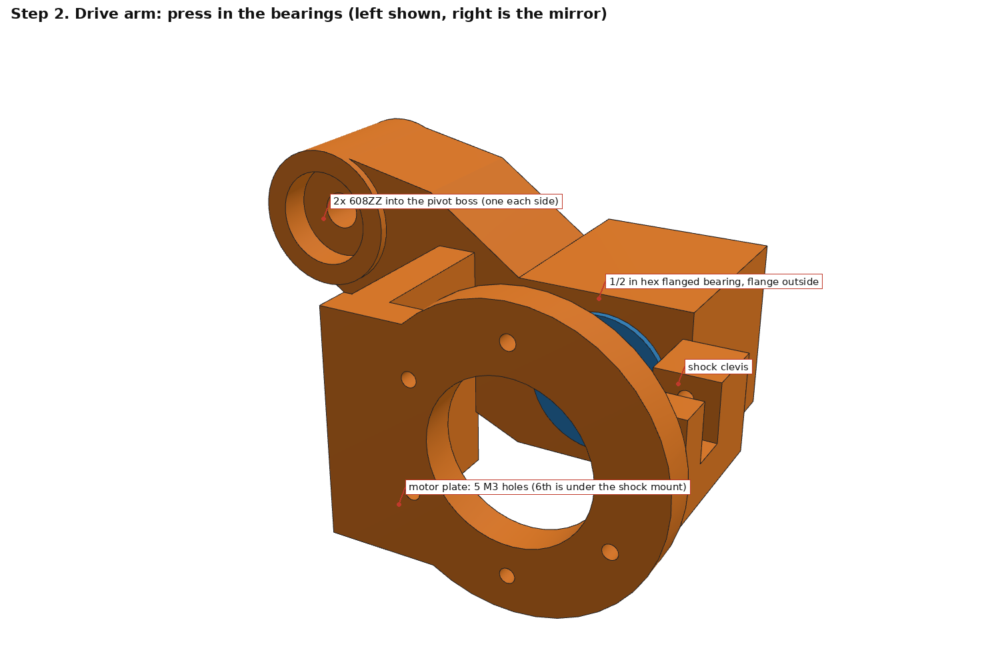
1. Press one 608ZZ into each side of the pivot boss.
2. Press the two 1/2 in hex flanged bearings into the bearing block, one from each end. The flanges stay outside.
3. Use a vice with flat jaws, not a hammer. If a bearing is loose, add a drop of CA glue. If it is too tight, warm the arm with a hair dryer.

### Step 3. RS00 and hex adapter
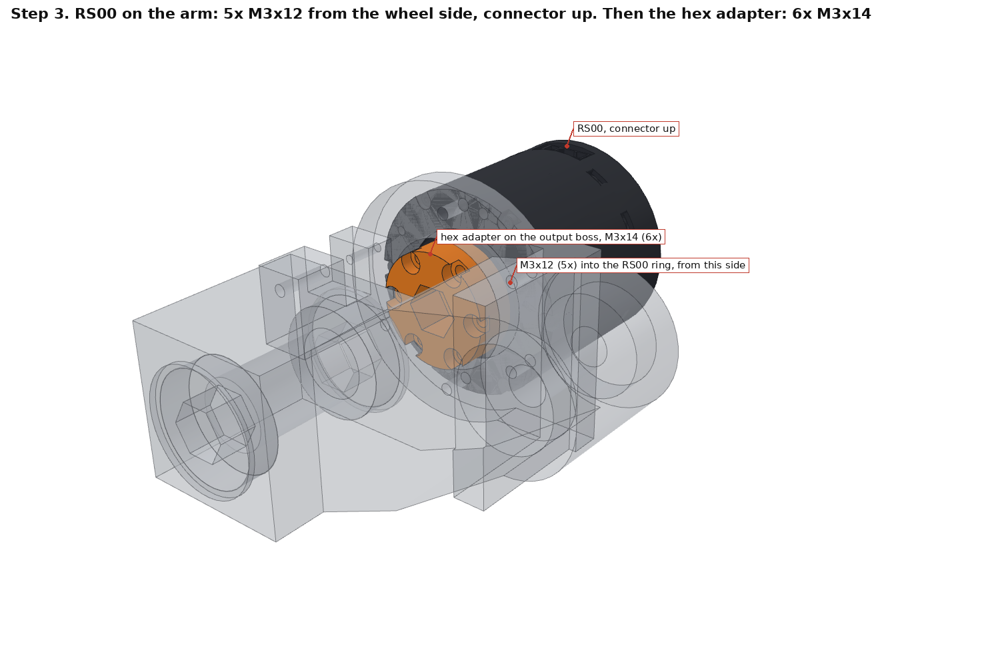
1. Set the RS00 against the motor plate from the inside (the side away from the wheel), connector up.
2. Fit 5x M3x12 from the wheel side into the RS00 fixed ring. Use a short hex key in the gap between the plate and the bearing block.
3. The 6th ring hole sits under the shock mount and stays empty. Five M3s carry the 14 N·m peak with a big margin.
4. Put the hex adapter on the output boss through the plate's centre hole, with the hex pocket facing the wheel.
5. Fit 6x M3x14. They go into the RS00 output's 6 mm-deep threads: do not use longer screws.

### Step 4. Shaft, collars and wheel
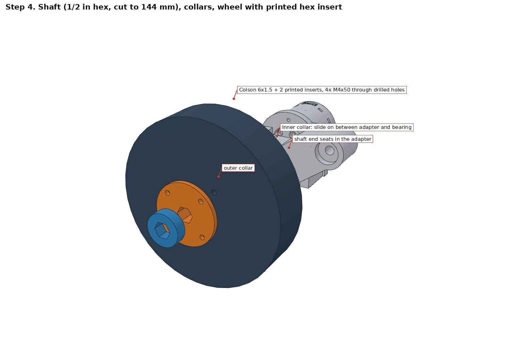
1. Cut the 1/2 in hex shaft to **144 mm** and deburr both ends.
2. Colson wheel only: press the two printed inserts into the bore from each side, flanges out.
   - Use the insert flange as a drill guide and drill 4x 4.5 mm holes through the wheel core.
   - Fit 4x M4x50, heads in the inner flange, nylocs outside.
3. Push the shaft in through the outer bearing. Thread the inner collar on in the gap between the shock mount and the inner bearing.
4. Push the shaft through the inner bearing until it seats in the hex adapter.
5. Slide the wheel on, then the outer collar.
6. Tighten both collars with about 0.5 mm of end play. The wheel must spin freely by hand with the RS00 unpowered.

### Step 5. Mount the drive modules
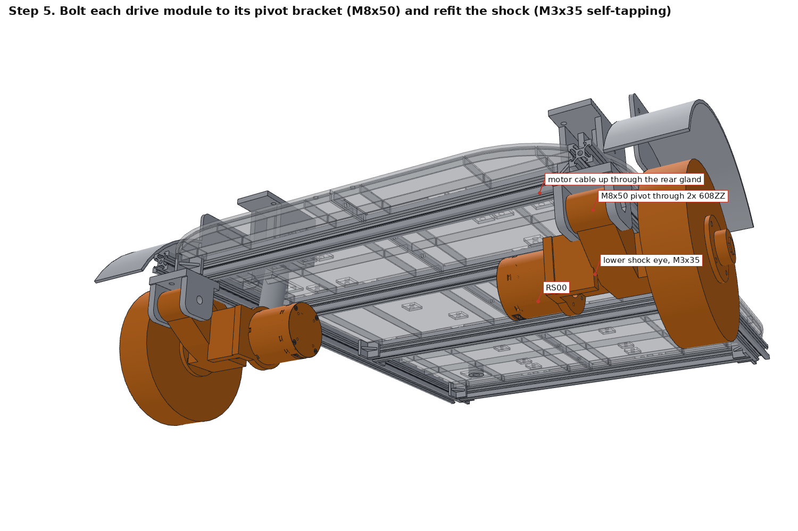
1. Feed the RS00 cable up through the rear gland on its side.
2. Lift the module into the pivot bracket. Slide the M8x50 through the bracket and the two 608ZZ, then tighten the nut until the arm swings freely with no wobble.
3. Refit the shock: lower eye into the arm's slot with M3x35, upper eye in the tower as before.
4. Set the spring collar so the shock is about **130 mm** eye to eye with the rover on the ground. The checks below show 104 mm at full bump, inside its stroke.

### Step 6. Grid tiles
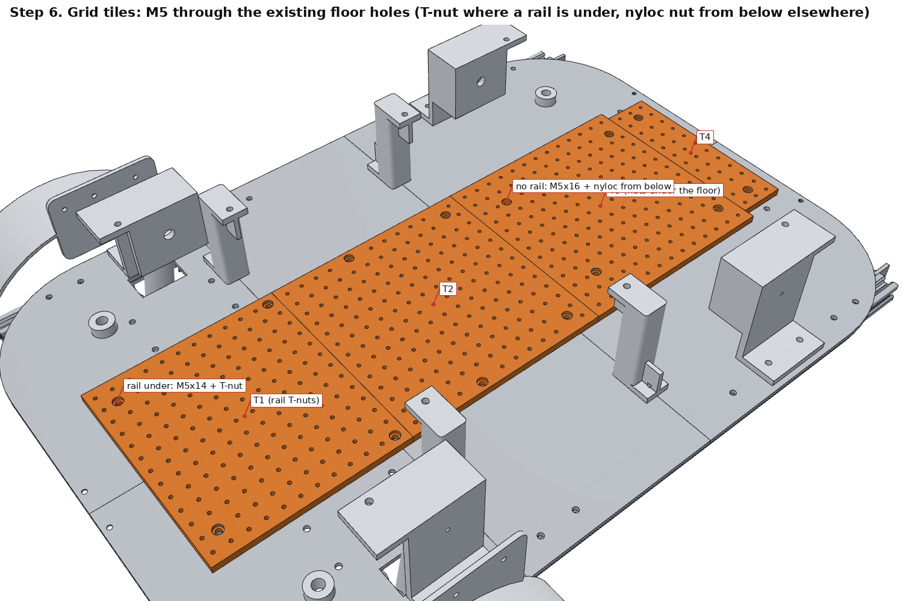
1. Push M3 nuts into the tile's nut pockets from below, only where you will mount something. Add more later by lifting the tile.
2. Put the tiles on the floor. Every mount hole lines up with a hole already in the printed floor.
   - **Over a rail** (T1 all four, T2 at x = 60, T4): use M5x12 into a drop-in T-nut. Drop the T-nut into the rail's top slot from below and twist it.
   - **No rail** (T2 at x = −43, T3): use M5x16 with a washer and nyloc from under the rover.

### Step 7. The green parts that carry the deck
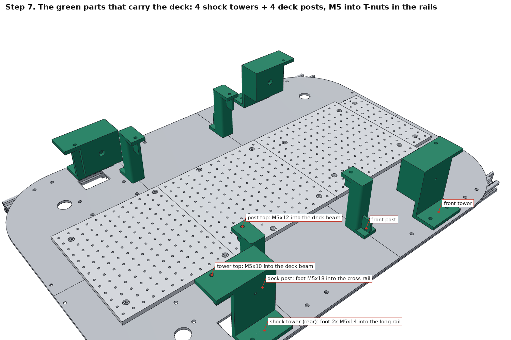
These eight parts hold the deck beams, the deck beams hold the tote guides, and the tote (the bag) sits in the guides.
1. **Print them:**
   - 4 shock towers + 4 deck posts, PETG, 4 walls, 30 % gyroid, in the orientation of the STL files (largest flat face down).
   - Left and right are mirror images: check the file name.
   - 4 walls matter more than infill: the loads go through the walls.
2. **T-nuts first.** Use drop-in (hammer-head) M5 T-nuts for 2020 so you don't have to take the frame apart:
   - 2 per tower in the long rail
   - 1 per post in the cross rail (x = −130 for the middle posts, x = 60 for the front posts)
   - 2 per deck beam in its bottom slot
3. **Towers:** stand each tower on the floor over the long rail and line up its two foot holes with the floor holes at x = ±152/192 (front) and −152/−192 (rear), y = ±224.5. Fit 2x M5x14 into the T-nuts, finger tight.
4. **Posts:** stand each post on its floor hole (x = −130 and 60, y = ±170 / ±180), open side facing outward. Fit 1x M5x18 into the cross-rail T-nut, finger tight.
5. **Rear towers only:** fit the upper shock eye with M3x25 self-tapping (step 5).

### Step 8. Deck beams and tote
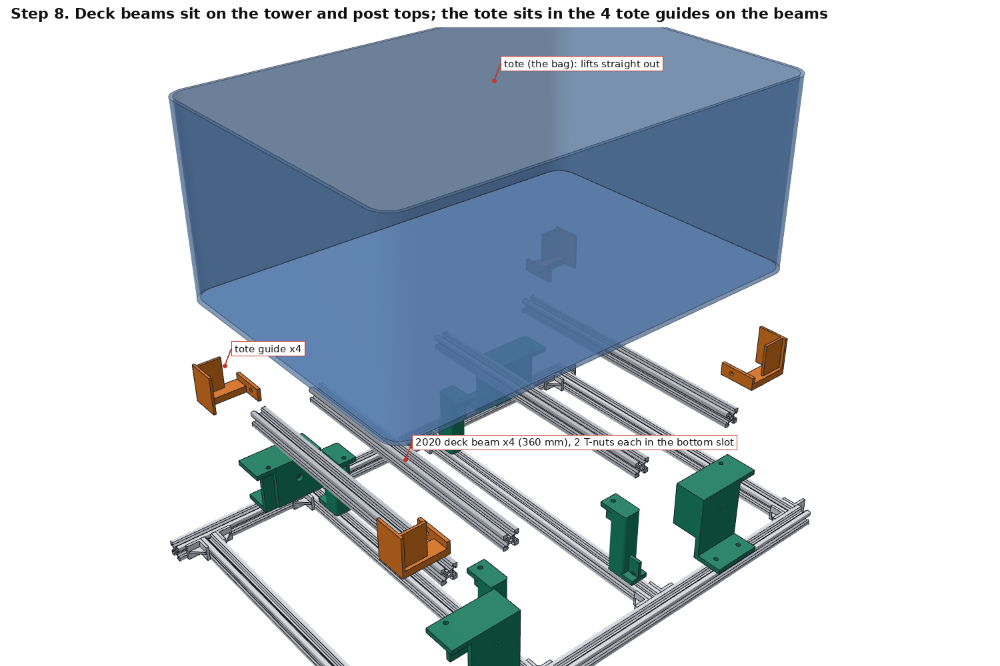
1. Cut 4x 2020 to 360 mm.
2. Set each beam across its pair of tops: beam 1 on the rear towers, beam 2 on the middle posts, beam 3 on the front posts, beam 4 on the front towers.
   - Fit M5x10 (tower tops) or M5x12 (post tops) into the T-nuts in the beam's bottom slot.
3. **Square everything.**
   - With all the beams on, measure the two diagonals of the deck. Push it square until they match within 2 mm.
   - Tighten the tops first, then the feet. The beams act as the jig.
4. Bolt the four tote guides onto the beams (as in v4.4).
5. Drop the tote in. It lifts straight out.

> Fit the grid tiles (step 6) **before** the deck beams. A 200 mm tile does not fit between the beams.

### Step 9. Battery
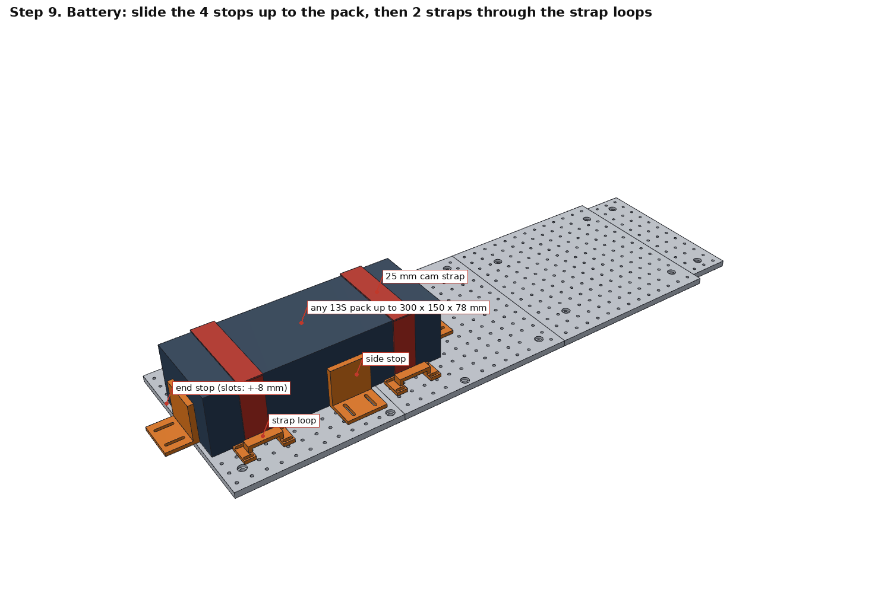
1. Set the pack on T1/T2 with its leads toward the front.
2. Bolt the rear stop up against it, then the front stop and the two side stops.
   - Each stop has slots that cover the 15 mm grid, so any pack size can be clamped snug.
   - Use 3 mm foam on the faces.
3. Bolt 4 strap loops beside the pack and run 2x 25 mm cam straps over it.
4. The pack stays in the rover for charging (step 11). To swap it, take off deck beams 1 and 2.

### Step 10. Electronics
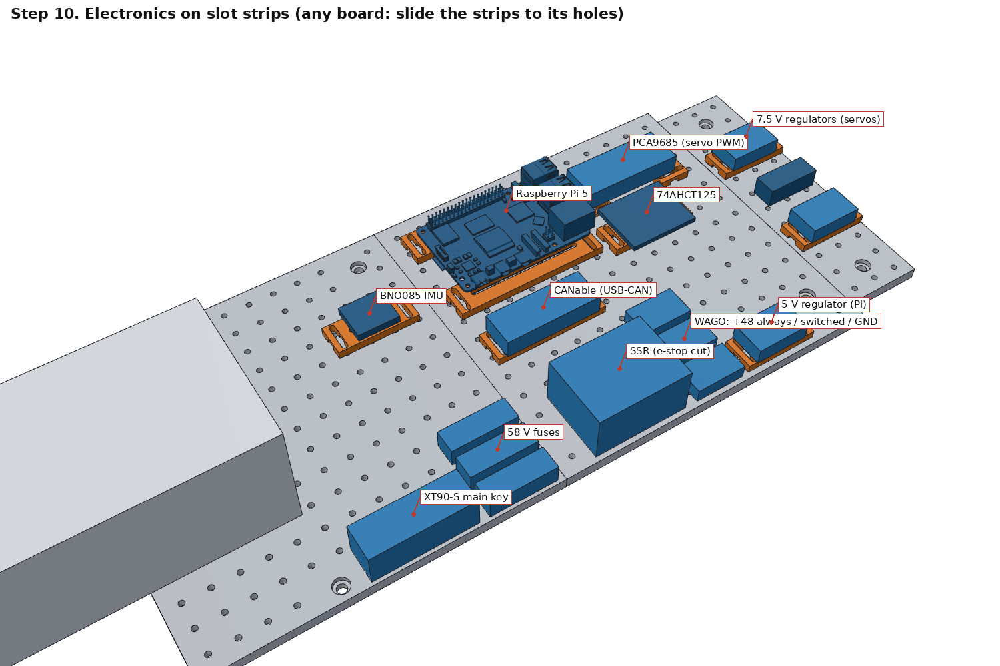
Mount each board on two slot strips. Slide nuts into the strip channel first, then bolt the strips to the grid at the board's hole spacing (for example 58 x 49 mm for the Pi 5).

| Where | What |
|---|---|
| T2, battery side | XT90-S main key, 15 A main fuse, 3 A (Pi) and 5 A (charge) fuses |
| T2, centre | BNO085 IMU (near the middle of the rover, flat, arrow forward) |
| T3 | Pi 5, CANable, PCA9685, 74AHCT125, SSR, 3 WAGO blocks, 5 V regulator |
| T4 | the two 7.5 V servo regulators, next to the steering glands, and the servo fuse |
| Hood | second NC contact block on the e-stop |
| Rear wall | charge socket in the printed plate inside the old C14 cutout (rain hood and flap stay) |

### Step 11. Wire it (section 4), then the first power-up (section 5)

---

## 4. Wiring

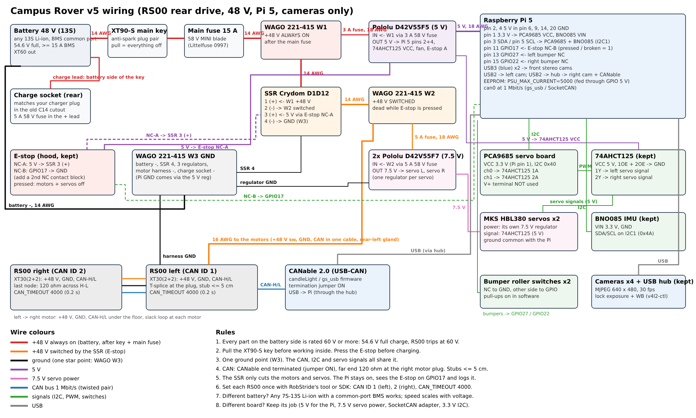

Do the steps in this order, with the XT90-S key **pulled** the whole time.

1. **Ground star (WAGO W3).** Battery −, SSR terminal 4, the GND of all three regulators, the motor harness GND and the charge-socket −. Use 14 AWG for the battery −, 18 AWG for the rest.
2. **Main feed.**
   - Battery XT60 → 14 AWG → XT90-S (main key) → 15 A 58 V fuse → WAGO W1 (+48 V always on).
   - Keep the run short and tie it down.
3. **Charge socket.**
   - Socket + → 5 A 58 V fuse → the battery side of the XT90-S, so charging works with the key pulled. Socket − → W3.
   - If your pack has a separate charge port, wire the socket to that port instead.
4. **Pi power.**
   - W1 → 3 A 58 V fuse → D42V55F5 VIN.
   - 5 V out → Pi 5 pins 2 and 4 (5 V) and pin 6 (GND), 18 AWG, as short as possible.
   - Also take 5 V to the 74AHCT125 VCC, the fan and the e-stop contact NC-A.
5. **SSR.**
   - W1 → SSR 1 (+). SSR 2 (−) → WAGO W2 (+48 V switched).
   - Control: 5 V → e-stop NC-A → SSR 3 (+). SSR 4 (−) → W3.
   - Pressing the e-stop opens NC-A, and the SSR drops the motors and servos.
6. **Servo power.**
   - W2 → 5 A 58 V fuse → both D42V55F7 inputs.
   - Each 7.5 V output → its own servo's power lead, through the existing servo fuse holder.
7. **Motor harness.** One cable from the bay through the rear-left gland: 16 AWG +48 V switched (from W2), 16 AWG GND (from W3) and the CAN twisted pair.
   - At the left RS00, splice a 5 cm tail to an XT30(2+2) female (+48 V, GND, CAN-H, CAN-L) and carry all four wires on under the floor to the right RS00.
   - At the right RS00, splice its plug the same way and solder the 120 Ω resistor across CAN-H and CAN-L at the end.
   - Leave a slack loop at each motor: the arm swings about 16°.
8. **CAN.**
   - CANable with its termination jumper ON → CAN-H/CAN-L twisted pair → the harness.
   - The CANable plugs into the USB hub (left wall).
9. **Logic.**
   - Pi pin 1 (3.3 V) → PCA9685 VCC and BNO085 VIN. Pin 3 (SDA) and pin 5 (SCL) → both boards. GND pin 9.
   - PCA9685 ch0 → 74AHCT125 1A → 1Y → left servo signal. ch1 → 2A → 2Y → right servo signal. Tie 1OE and 2OE to GND.
   - Do **not** connect the PCA9685's V+ terminal.
10. **Switches.**
    - E-stop NC-B → GPIO17 (pin 11) and GND (pin 14).
    - Left bumper NC → GPIO27 (pin 13); right bumper NC → GPIO22 (pin 15); common → GND (pin 20).
    - Wired NC to ground, a broken wire reads the same as "pressed", so the rover stops.
11. **USB.** Front stereo cameras into the two blue USB3 ports (separate controllers). Left camera into a black USB2 port. The hub into the other USB2 port, carrying the right camera and the CANable.

---

## 5. First power-up

1. **Before plugging in:**
   - With the key out, check W1 and W2 to W3 with a meter: no short.
   - Press the e-stop.
2. **Plug in the XT90-S.**
   - The Pi boots. W1 reads the pack voltage. W2 reads near 0 V with the e-stop pressed.
   - The SSR leaks about 0.3 mA when off, so a meter may show a few volts on W2 with no load. That is normal.
3. **Pi setup, once:**
   - Set the power-supply limit for powering through the GPIO pins, then reboot:
     ```bash
     sudo rpi-eeprom-config --edit
     ```
     Add `PSU_MAX_CURRENT=5000`, save, and reboot.
   - Bring up the CAN bus at 1 Mbit/s:
     ```bash
     sudo ip link set can0 up type can bitrate 1000000
     ```
4. **Release the e-stop.** W2 comes up and the RS00s power on disabled: they don't move until told to.
5. **Set the motor IDs, one motor at a time** (unplug the other):
   - CAN ID 1 = left, 2 = right.
   - `CAN_TIMEOUT` = 4000 (0.2 s; 20000 = 1 s): if the Pi stops talking, the motor resets and stops.
   - Use RobStride's PC tool or their Python SDK ([RobStride Dynamics SDK](https://github.com/ROBSTRIDE-DYNAMICS/Robstride-Dynamics-Python-SDK), SocketCAN).
6. **Wheels off the ground:**
   - Spin each wheel slowly in velocity mode and check the direction. The left and right motors face opposite ways, so one needs a negative sign.
   - Then centre the steering servos at 1520 µs (as in v4.4) through the PCA9685 at 50 Hz.
7. **Check the safety chain:**
   - Press the e-stop while a wheel spins: it must stop at once, and GPIO17 must read 1.
   - Press each bumper: its GPIO must change.
8. **Battery voltage:**
   - Read it from the RS00's `VBUS` parameter (0x300C).
   - Warn below 45 V (3.5 V per cell). The BMS cuts off on its own below that.

**Limits to keep in software:**
- Brake gently: under 0.5 m/s² on steep downhills, as in v4.4.
- On a full 54.6 V pack, hard braking pushes the voltage toward the RS00's 60 V trip, so watch `VBUS` and coast if it passes 57 V.
- Never charge with the e-stop released.

---

## 6. What was checked, and what is assumed

Checked in CAD (`cad/assemble_v5.py`, results in `checks.json`):

- **No overlaps:** 0 overlaps between any new or moved part and the rest of the rover. This includes the RS00 against the arm, the frame, the floor and the gland, and the tiles against the tub and posts.
- **Suspension sweep:**
  - The whole left drive module (arm, RS00, adapter, shaft, bearings, collars, wheel, inserts) swept through −4 to +20 mm of wheel travel, matching v4.4's travel.
  - 0 hits against the rails, brackets, floor, fender, tower, gland and the moving shock body.
  - The shock goes from 135.6 mm at −4 mm travel to 103.8 mm at +20 mm: inside a 140 mm, 40 mm-stroke shock.
  - Lowest point at ride height: the arm's motor plate, 43 mm off the ground. The front C-hubs (41 mm) are still the lowest parts.
- **Battery space:** a 300 x 150 x 78 mm pack in the cradle hits nothing. The deck beams are 81.9 mm above the tile tops.
- **Print size:** every printed part fits a 220 x 220 mm bed.

Where the numbers came from:

- **RS00:** RobStride's official STEP and manual ([RobStride/Product_Information](https://github.com/RobStride/Product_Information), RS00-20261117.stp and RS00 User Manual 260713).
  - Output: 6x M3 on a Ø27 circle, 6 mm deep. Fixed ring: 6x M3 on Ø50, 5 mm deep. Back face: 4x M3 on Ø38.
  - Ø57 x 52.1 mm, 310 g, 24–60 V, over-voltage trip 60 V, under-voltage 12 V.
  - CAN 1 Mbit/s, XT30(2+2) connector.
- **Frame, pivot, shock eyes, floor holes and green parts:** the v4.4 STEP files from your Onshape document.
- **Bearing:** AndyMark am-2986 (1.125 in OD, 0.312 in). **Colson bore:** WCP-1536 (1-3/16 in). **Regulators:** Pololu D42V55F5/F7 (60 V input). **SSR:** Sensata Crydom D1D12 (100 V, 12 A).

Assumptions (not measured):

- Board outlines for the D42V55 regulators, the CANable and the WAGOs are approximate boxes in the CAD. Put the strips where the real holes are.
- The 6x1.5 wheel is modelled as a plain tyre. Check your wheel's core is solid where the 4 M4 holes go: a 45 mm circle, outside the bore.
- The RS00's allowed radial load isn't published. The two bearings in the arm carry the wheel, so the motor only gets torque through the hex.
- Runtime and weight are estimates. Empty weight is about 12 to 13 kg, assuming about 2.7 kg per old hub motor; weigh it.
